# Лабораторная работа №2. Облачные вычислительные сервисы. Amazon EC2

- **ФИО:** Бугаенко Никита Игоревич
- **Группа:** I-2402
- **Специальность:** Информатика
- **Уровень:** Продвинутый (Часть 1 и Часть 2, задания 1–14)
- **Приложение:** TimeCapsule, вариант `open_capsules_php_functional` (PHP без фреймворка)
- **Вариант деплоя:** B, скрипт `deploy.sh`

## Постановка задачи

Требуется запустить виртуальную машину Amazon EC2. Требуется подключиться к ней по SSH, проверить её состояние и опубликовать на ней статический веб-сайт. Требуется остановить экземпляр через AWS CLI.

Во второй части требуется развернуть на этом экземпляре веб-приложение TimeCapsule с базой данных PostgreSQL. Сервер должен забирать код из репозитория GitHub. Требуется выпустить новую версию приложения, сломать его и откатить изменение через репозиторий. Требуется нарисовать схему развёртывания и записать архитектурное решение (ADR).

## Цель работы

Получить практические навыки запуска, настройки и диагностики экземпляров Amazon EC2. Получить навыки развёртывания статического сайта и приложения с базой данных. Получить навыки доставки кода из репозитория на сервер и отката неудачной версии.

## Основные этапы работы

1. Подготовка аккаунта AWS: пользователь IAM и бюджет `ZeroSpend`.
2. Запуск экземпляра EC2 с веб-сервером nginx.
3. Мониторинг и диагностика экземпляра.
4. Подключение к экземпляру по SSH.
5. Публикация статического сайта.
6. Остановка экземпляра через AWS CLI.
7. Создание организации и репозитория на GitHub.
8. Установка PHP, PostgreSQL и Composer на сервер.
9. Настройка базы данных PostgreSQL.
10. Развёртывание кода приложения на сервере.
11. Настройка PHP-FPM и nginx.
12. Обновление приложения скриптом `deploy.sh`.
13. Выпуск новой версии, поломка и откат.
14. Схема архитектуры и ADR.

## Параметры среды

| Параметр       | Значение                           |
| -------------- | ---------------------------------- |
| Регион         | `eu-north-1` (Stockholm)           |
| AMI            | Amazon Linux 2023                  |
| Тип экземпляра | `t3.micro`                         |
| Имя экземпляра | `webserver`                        |
| Security Group | `webserver-sg`: SSH (22) с `My IP`, HTTP (80) с `0.0.0.0/0` |
| Веб-сервер     | nginx 1.30.5                       |
| PHP            | PHP 8.4.25, PHP-FPM                |
| База данных    | PostgreSQL 16                      |

## Ход работы

### Задание 1. Подготовка аккаунта

Я создал группу IAM `Admins` с политикой `AdministratorAccess`. Я создал пользователя `cloudstudent` с доступом к консоли и добавил его в группу `Admins`. Дальнейшую работу я выполнял под этим пользователем.

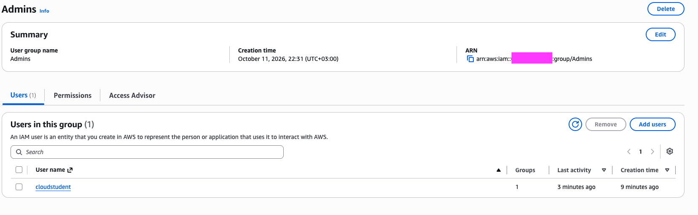

*Группа IAM `Admins` содержит пользователя `cloudstudent`.*

Я создал бюджет по шаблону `Zero spend budget` с именем `ZeroSpend`. Бюджет отправляет письмо, когда фактические расходы превышают $0.01.

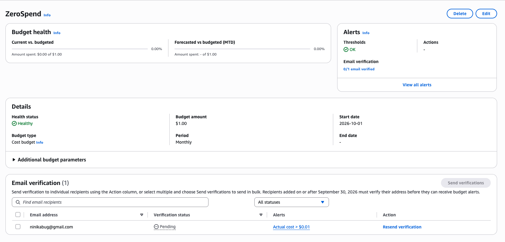

*Бюджет `ZeroSpend` создан, текущие расходы равны $0.00.*

### Задание 2. Запуск экземпляра EC2

Я запустил экземпляр `webserver` с параметрами из таблицы выше. Для ключа SSH я выбрал тип ED25519 и формат `.pem`. В поле User data я указал скрипт. Скрипт обновляет систему, устанавливает `htop` и `nginx` и запускает nginx:

```bash
#!/bin/bash
dnf -y update
dnf -y install htop nginx
systemctl enable --now nginx
```

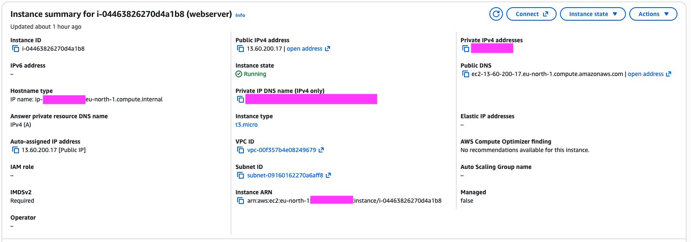

*Экземпляр `webserver` находится в состоянии `Running`, у него есть публичный IP-адрес.*


*Все три проверки состояния экземпляра пройдены.*

### Задание 3. Мониторинг и диагностика

Я открыл вкладку `Status and alarms`. Все проверки состояния пройдены (см. задание 2).

Я открыл вкладку `Monitoring`. Вкладка показывает метрики Amazon CloudWatch: загрузку процессора, сетевой трафик и кредиты CPU.

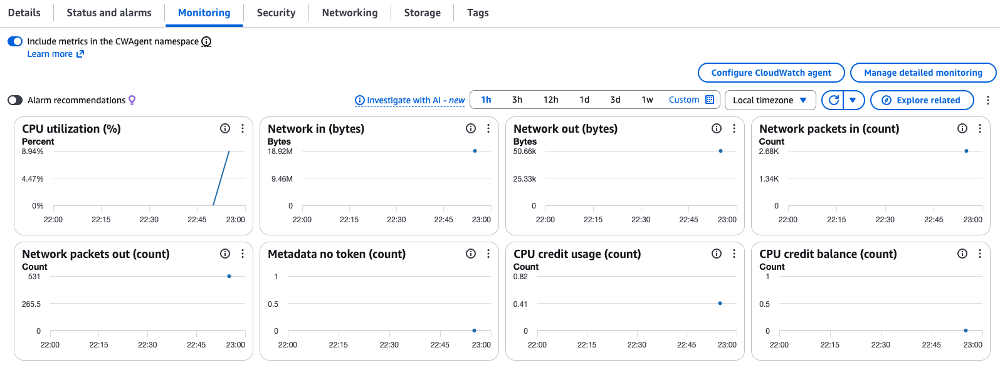

*Метрики CloudWatch экземпляра на вкладке `Monitoring`.*

Я открыл системный журнал экземпляра (`Get system log`). В журнале есть строки установки nginx. Эти строки записала служба cloud-init при выполнении скрипта User data.

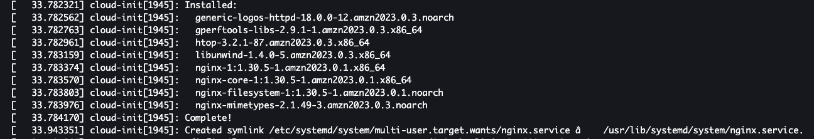

*Фрагмент `System log`: cloud-init устанавливает пакеты `htop` и `nginx`.*

Я получил снимок экрана экземпляра (`Get instance screenshot`). Снимок показывает загрузку Amazon Linux 2023.

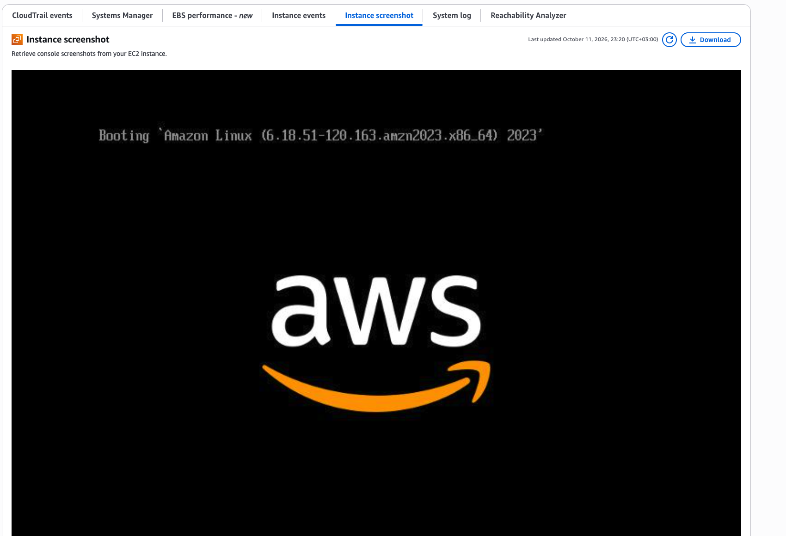

*Снимок экрана экземпляра во время загрузки ОС.*

### Задание 4. Подключение по SSH

Я ограничил права на файл ключа командой `chmod 400`. Я подключился к экземпляру по SSH как пользователь `ec2-user`. Команда `systemctl status nginx` показывает, что служба nginx активна (`active (running)`) и включена (`enabled`).

```bash
chmod 400 ~/.ssh/bysinka_95-keypair.pem
ssh -i ~/.ssh/bysinka_95-keypair.pem ec2-user@<Public-IP>
systemctl status nginx
```

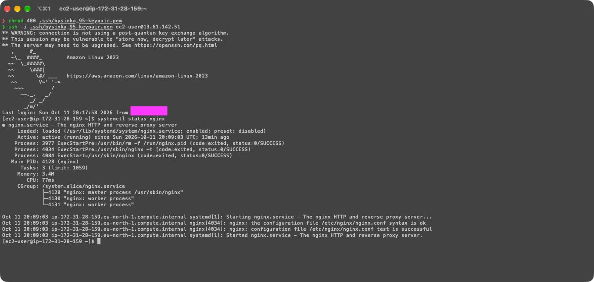

*Подключение по SSH выполнено, служба nginx работает.*

### Задание 5. Статический сайт

Я создал три HTML-файла: `index.html`, `about.html` и `contact.html`. Каждая страница содержит ссылки на две другие страницы. Я скопировал файлы на сервер командой `scp`:

```bash
scp -i ~/.ssh/bysinka_95-keypair.pem index.html about.html contact.html ec2-user@<Public-IP>:~
```

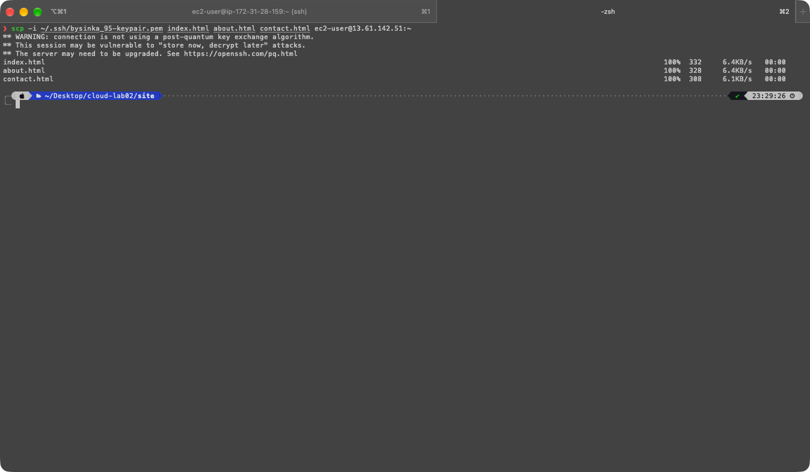

*Команда `scp` скопировала три файла на сервер.*

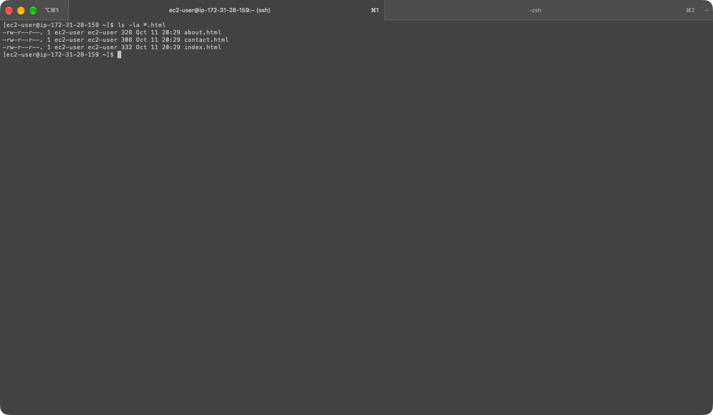

*Файлы находятся в домашней папке пользователя `ec2-user`.*

Папка `/usr/share/nginx/html` принадлежит пользователю `root`. Поэтому я скопировал файлы в неё через `sudo`:

```bash
sudo cp ~/*.html /usr/share/nginx/html/
ls -l /usr/share/nginx/html
```

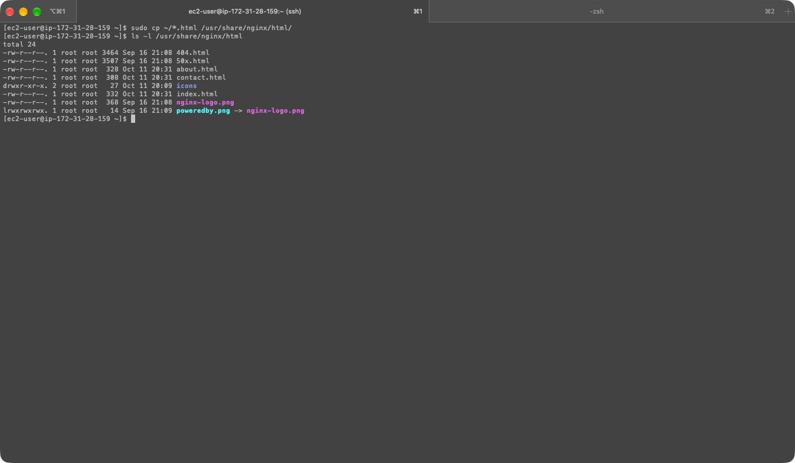

*Файлы сайта находятся в папке `/usr/share/nginx/html`.*

Я открыл сайт в браузере по публичному DNS-имени экземпляра. Ссылки между страницами работают.

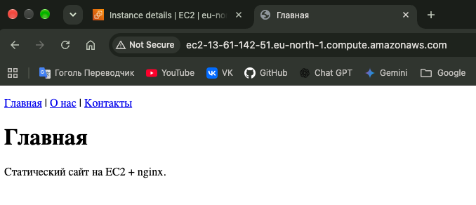

*Страница «Главная».*

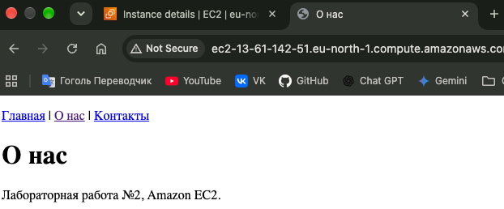

*Страница «О нас».*

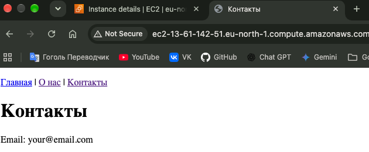

*Страница «Контакты».*

**Проблема и её решение.** Сначала браузер не открыл сайт: соединение завершилось по таймауту. Причина: браузер автоматически перешёл на протокол HTTPS (порт 443). Security Group не разрешает входящий трафик на порт 443, поэтому пакеты не доходили до сервера. Решение: указать в адресе протокол явно — `http://<Public-IP>`.

### Задание 6. Остановка экземпляра через AWS CLI

Я остановил экземпляр в AWS CloudShell. В CloudShell AWS CLI уже установлен и использует права текущего пользователя.

```bash
aws ec2 stop-instances --instance-ids <ID-экземпляра> --region eu-north-1
```

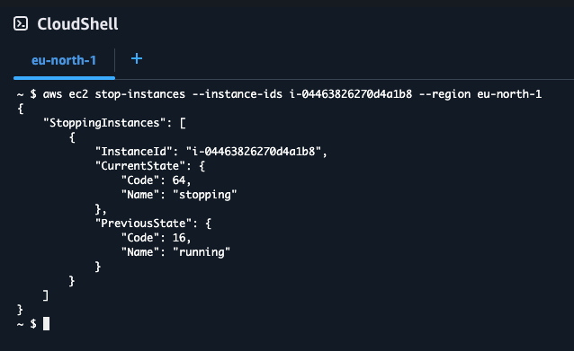

*Вывод команды: экземпляр перешёл из состояния `running` в состояние `stopping`.*

## Часть 2. Продвинутый уровень

### Задание 7. Организация и репозиторий на GitHub

Я создал организацию GitHub `bysinka-95-cloud` на плане Free. В организации я создал публичный репозиторий `timecapsule`. Я скопировал в него приложение `open_capsules_php_functional` из репозитория `msu-cloud-course/app-samples`:

```bash
git clone https://github.com/msu-cloud-course/app-samples.git
mkdir timecapsule
cp -r app-samples/open_capsules_php_functional/. timecapsule/
cd timecapsule
git init -b main
git add .
git commit -m "Initial import of TimeCapsule"
git remote add origin https://github.com/bysinka-95-cloud/timecapsule.git
git push -u origin main
```

В корне репозитория находятся папки `public`, `src`, `views` и файл `composer.json`.

### Задание 8. Подготовка сервера

Я запустил экземпляр `webserver` и подключился к нему по SSH. После запуска экземпляр получил новый публичный IP-адрес. Я установил пакеты для приложения:

```bash
sudo dnf -y install git composer postgresql16-server \
    php8.4-fpm php8.4-cli php8.4-pgsql php8.4-mbstring php8.4-xml
```

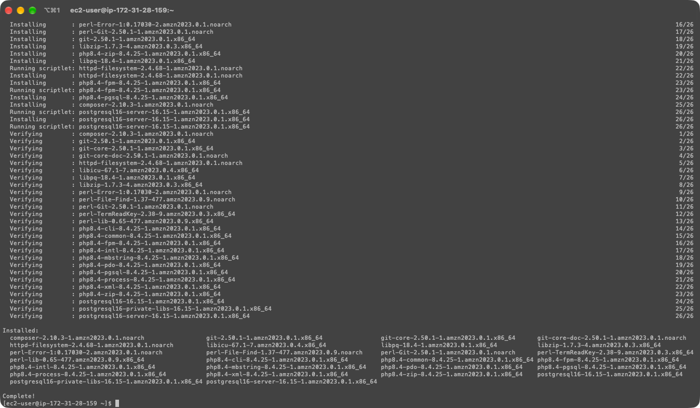

*Пакеты `git`, `composer`, `php8.4-*` и `postgresql16-server` установлены.*

Я проверил версию PHP и драйвер PostgreSQL:

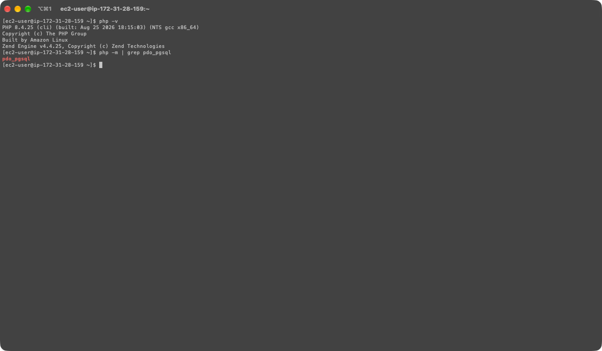

*Установлен PHP 8.4.25, модуль `pdo_pgsql` загружен.*

### Задание 9. База данных PostgreSQL

Я создал файлы базы данных командой `postgresql-setup --initdb`. В файле `pg_hba.conf` подключения через `localhost` используют метод `ident`. Этот метод не принимает пароль. Я заменил `ident` на `scram-sha-256`, то есть на проверку по паролю. Я запустил PostgreSQL и создал пользователя и базу `timecapsule`:

```bash
sudo postgresql-setup --initdb
sudo sed -i 's/ident$/scram-sha-256/' /var/lib/pgsql/data/pg_hba.conf
sudo systemctl enable --now postgresql
sudo -u postgres psql -c "CREATE USER timecapsule WITH PASSWORD '***';"
sudo -u postgres psql -c "CREATE DATABASE timecapsule OWNER timecapsule;"
psql -h localhost -U timecapsule -d timecapsule -c "SELECT 1;"
```

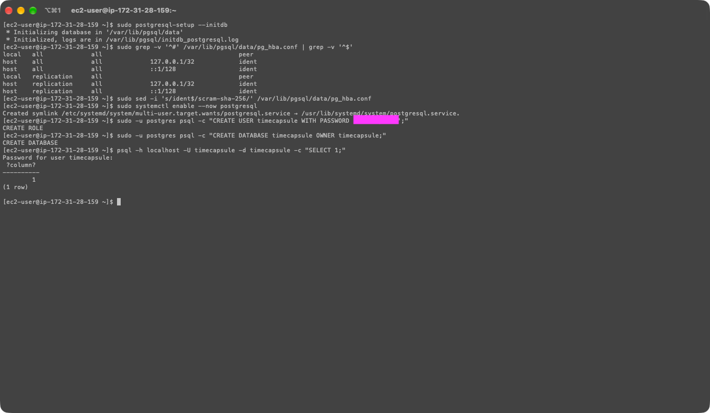

*Запрос `SELECT 1` с паролем выполнен успешно, база готова.*

### Задание 10. Развёртывание кода приложения на сервере

Я создал папку `/var/www/timecapsule` и сделал пользователя `ec2-user` её владельцем. Я склонировал в неё репозиторий по HTTPS. Репозиторий публичный, поэтому серверу не нужны ключи для чтения.

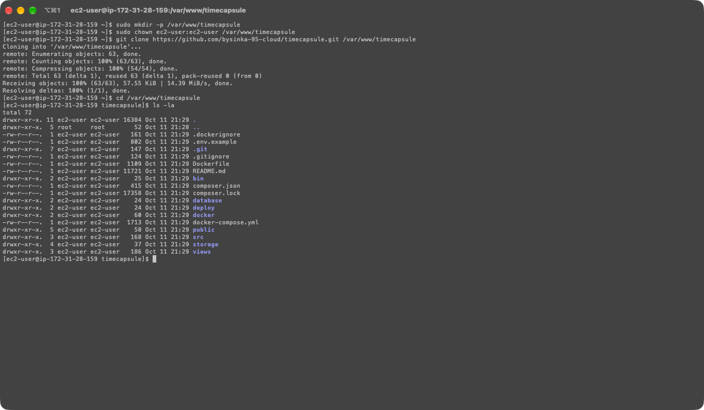

*Код из репозитория `bysinka-95-cloud/timecapsule` находится в `/var/www/timecapsule`.*

Я создал файл `.env` с настройками приложения и паролем к базе. Я ограничил права на файл. PHP-FPM работает от имени пользователя `apache`, поэтому группа `apache` может читать `.env`, а папка `storage` принадлежит `apache`:

```bash
chmod 640 .env
sudo chgrp apache .env
sudo chown -R apache:apache storage
```

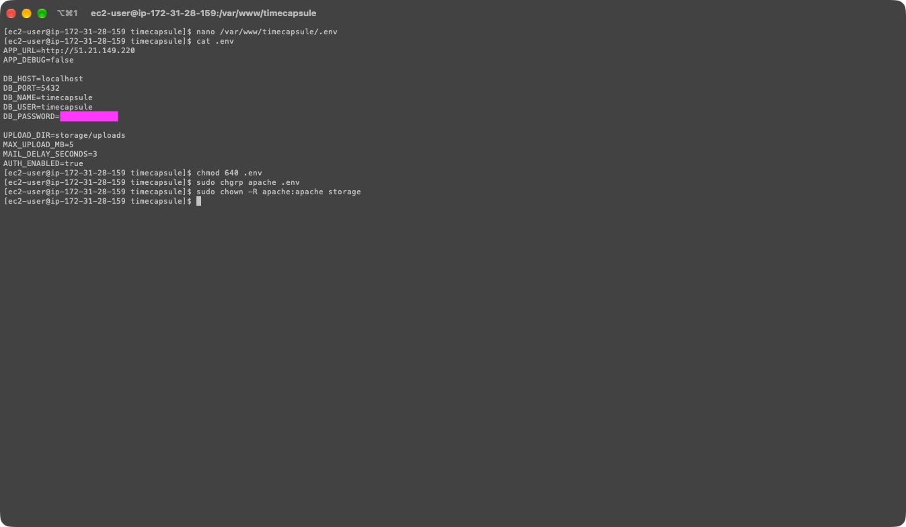

*Файл `.env` создан, пароль к базе на скриншоте закрыт.*

Я установил библиотеки и создал таблицы:

```bash
composer install --no-dev --optimize-autoloader
php bin/init-db.php
```

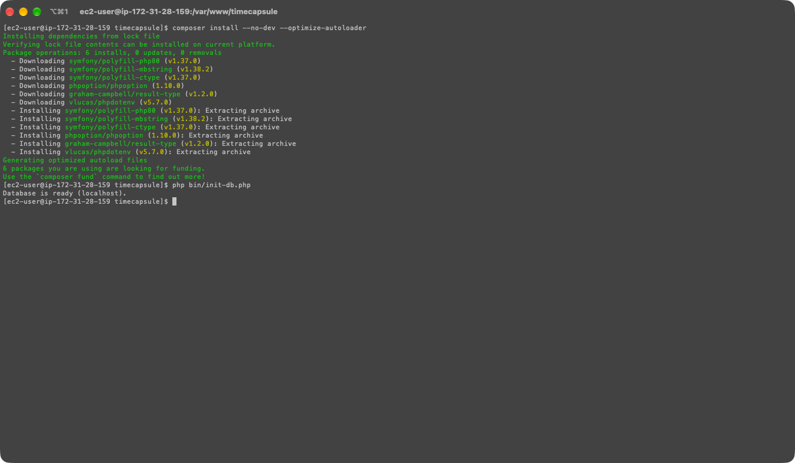

*Composer установил 6 пакетов, `init-db.php` сообщил `Database is ready`.*

### Задание 11. Настройка PHP-FPM и nginx

Я увеличил в `/etc/php.ini` лимит `upload_max_filesize` до 6 МБ. Я создал файл `/etc/nginx/conf.d/timecapsule.conf`. В нём nginx отдаёт файлы из `public/`, а запросы к PHP передаёт в PHP-FPM через unix-сокет `/run/php-fpm/www.sock`. Доступ к скрытым файлам (`.env`, `.git`) запрещён. Я проверил конфигурацию, запустил PHP-FPM и перезапустил nginx:

```bash
sudo nginx -t
sudo systemctl enable --now php-fpm
sudo systemctl restart nginx
```

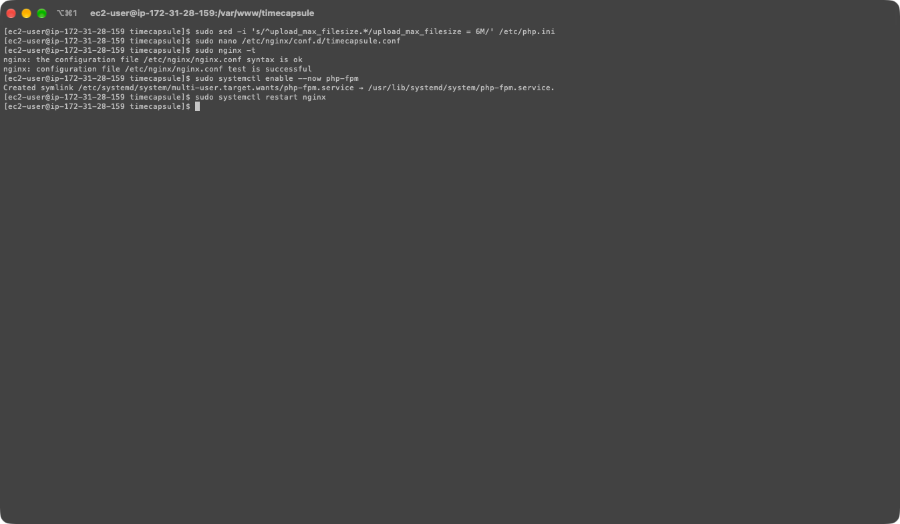

*`nginx -t` не нашёл ошибок, PHP-FPM запущен, nginx перезапущен.*

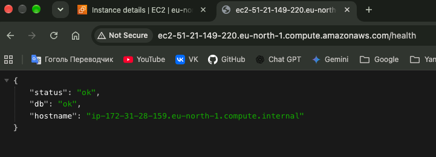

*Адрес `/health` возвращает `"status": "ok"` и `"db": "ok"`.*

### Задание 12. Обновление приложения

Я выбрал вариант B. Я создал на сервере скрипт `~/deploy.sh`. Скрипт выполняет `git pull --ff-only`, `composer install`, `php bin/init-db.php` и `systemctl reload php-fpm`. Строка `set -euo pipefail` останавливает скрипт при первой ошибке. В конце скрипт печатает коммит, который работает на сервере.

Сначала я запустил скрипт на сервере. Затем я запустил его со своего компьютера одной командой:

```bash
ssh -i ~/.ssh/bysinka_95-keypair.pem ec2-user@<Public-IP> ./deploy.sh
```

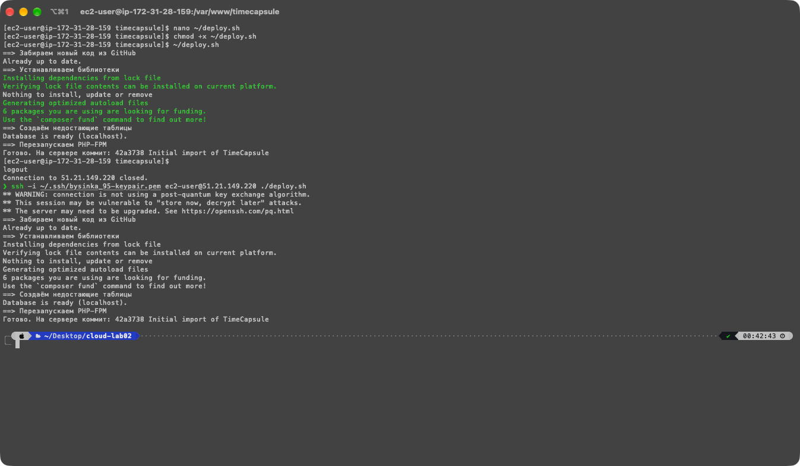

*Вывод `deploy.sh` при запуске на сервере и со своего компьютера через `ssh`.*

### Задание 13. Новая версия, поломка и откат

**Проверка приложения.** Я зарегистрировался и создал капсулу с датой открытия через 2 минуты. В назначенное время капсула открылась.

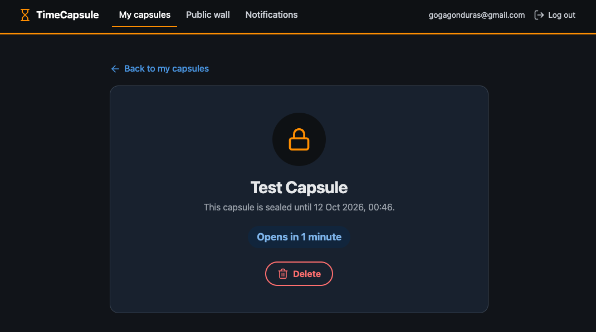

*Капсула закрыта до 00:46.*

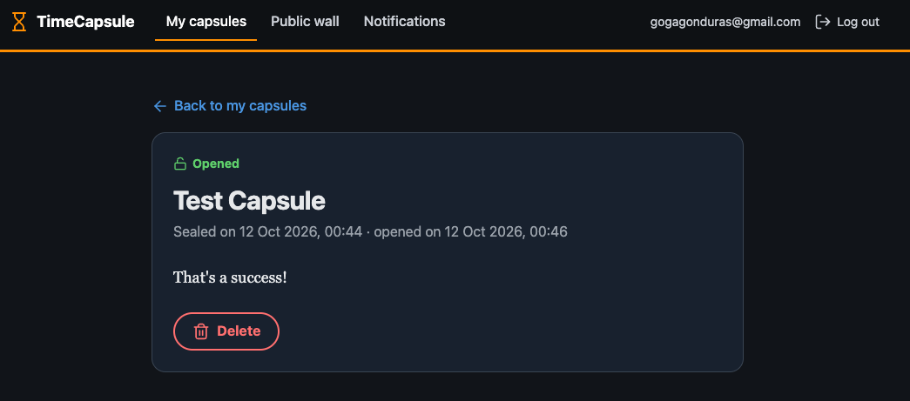

*Капсула открылась в 00:46.*

**Новая версия.** Я добавил в подвал страницы (`views/layout.php`) строку с именем автора. Я отправил коммит `Show author in footer` в репозиторий и выполнил деплой. Изменение появилось на странице, капсула сохранилась.

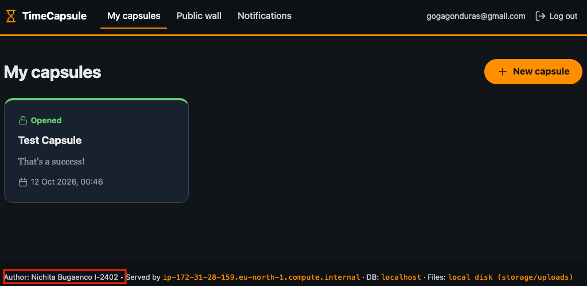

*В подвале страницы появилась строка «Author: Nichita Bugaenco I-2402», капсула на месте.*

**Поломка.** Я добавил в конец `views/layout.php` строку с синтаксической ошибкой `<?php broken(`. Я отправил коммит `Break the app` и выполнил деплой. Главная страница возвращает ошибку 500. Адрес `/health` при этом отвечает `ok`.

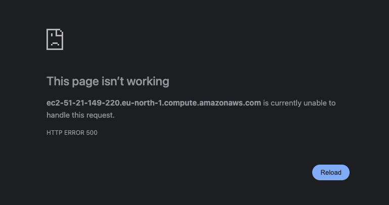

*Главная страница возвращает HTTP 500.*

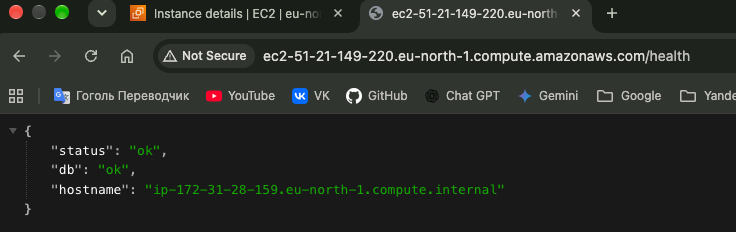

*Адрес `/health` отвечает `ok`, хотя главная страница не работает.*

**Откат.** Я не исправлял код на сервере. Я отменил последний коммит на своём компьютере и выполнил деплой:

```bash
git revert --no-edit HEAD
git push
ssh -i ~/.ssh/bysinka_95-keypair.pem ec2-user@<Public-IP> ./deploy.sh
```

Команда `git revert` создала коммит `Revert "Break the app"`. История не изменилась: в ней видно, что ошибку внесли и затем отменили. После деплоя сайт снова работает.

### Задание 14. Архитектура и решение

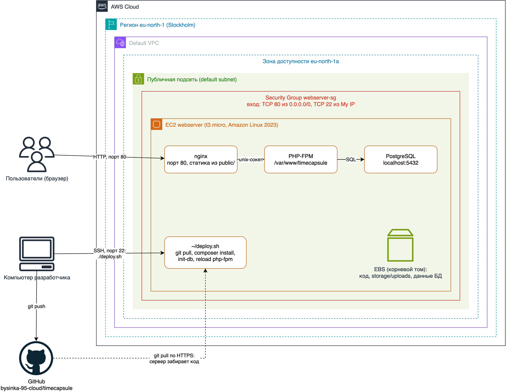

*Схема развёртывания TimeCapsule на одном экземпляре EC2.*

На схеме пользователи отправляют запросы по HTTP на порт 80. Security Group `webserver-sg` пропускает порт 80 из интернета и порт 22 только с моего IP-адреса. Внутри экземпляра nginx передаёт запросы в PHP-FPM, а PHP-FPM обращается к PostgreSQL на `localhost`. Код, загруженные файлы и данные базы хранятся на корневом томе EBS. Разработчик отправляет код в GitHub командой `git push` и запускает `deploy.sh` по SSH. Сервер забирает код из GitHub по HTTPS.

Архитектурное решение о способе деплоя записано в ADR: [docs/adr/0001-deploy-method.md](https://github.com/bysinka-95-cloud/timecapsule/blob/main/docs/adr/0001-deploy-method.md). В ADR сравниваются копирование через `scp`, ручной `git pull` на сервере, скрипт `deploy.sh` и CI/CD.

## Ответы на контрольные вопросы

### Вопросы из заданий

1. **Что разрешает политика `AdministratorAccess`? Почему для повседневной работы нельзя использовать root?**

   Политика `AdministratorAccess` разрешает все действия (`*`) со всеми ресурсами (`*`) во всех сервисах AWS. Пользователь root имеет неограниченный доступ к аккаунту. Политики IAM не могут ограничить root. Если злоумышленник получит данные root, он получит полный контроль над аккаунтом и платёжными данными. Поэтому root используют только для редких задач, которые доступны только ему. Для ежедневной работы используют пользователя IAM.

2. **Что такое User data и когда выполняется этот скрипт? Выполнится ли он повторно после перезагрузки экземпляра?**

   User data — это данные, которые передаются экземпляру при запуске. Если данные начинаются с `#!`, служба cloud-init выполняет их как скрипт от имени root. Скрипт выполняется один раз, при первой загрузке экземпляра. После перезагрузки или после остановки и запуска скрипт по умолчанию не выполняется повторно.

3. **Какая из проверок укажет на проблему, которую можете исправить вы, а какая на проблему на стороне AWS?**

   System status check показывает проблемы на стороне AWS: отказ физического сервера, сети или питания. Пользователь не может исправить эту проблему напрямую. Пользователь может остановить и снова запустить экземпляр, тогда AWS перенесёт его на другой сервер. Instance status check показывает проблемы внутри виртуальной машины: ошибку конфигурации ОС, ошибку сети, заполненный диск. Эти проблемы исправляет пользователь.

4. **В каких случаях стоит включать детальный мониторинг?**

   Детальный мониторинг передаёт метрики раз в минуту, а не раз в 5 минут. Его включают для рабочих систем, где важно быстро обнаружить проблему. Его также включают для Auto Scaling, чтобы группа быстрее реагировала на рост нагрузки. Детальный мониторинг полезен при поиске причин коротких пиков нагрузки.

5. **Почему для входа на экземпляр EC2 используется ключ, а не пароль?**

   Вход по ключу использует асимметричную криптографию. Открытый ключ хранится на сервере в файле `~/.ssh/authorized_keys`. Закрытый ключ хранится только у пользователя и не передаётся по сети. Подобрать ключ перебором практически невозможно, а пароль подобрать можно. По этой причине в образах AWS вход по паролю по умолчанию отключён.

6. **Что делает команда `scp` и чем она похожа на `ssh`?**

   Команда `scp` копирует файлы между компьютерами по сети. Она использует протокол SSH. Поэтому `scp` использует тот же порт 22, тот же ключ (`-i`) и тот же формат адреса `пользователь@хост`. Данные передаются в зашифрованном виде. Разница в том, что `ssh` открывает командную оболочку, а `scp` только передаёт файлы.

7. **Чем `Stop` отличается от `Terminate`? За что вы продолжаете платить, пока экземпляр остановлен?**

   `Stop` выключает экземпляр. Корневой том EBS и данные на нём сохраняются. Экземпляр можно запустить снова, но он получит новый публичный IP-адрес. `Terminate` удаляет экземпляр навсегда. Корневой том EBS по умолчанию тоже удаляется. Пока экземпляр остановлен, AWS не берёт плату за вычисления. Плата за тома EBS, их снимки и закреплённые Elastic IP сохраняется.

8. **Почему папка `vendor/` и файл `.env` не попали в репозиторий?**

   Файл `.gitignore` содержит строки `/vendor/` и `/.env`, поэтому git не отслеживает эти пути. Папка `vendor/` содержит библиотеки. Команда `composer install` создаёт её заново по файлам `composer.json` и `composer.lock`. Файл `.env` содержит пароли и настройки конкретного сервера. Репозиторий публичный, поэтому эти данные в нём хранить нельзя. В репозитории есть только шаблон `.env.example`.

9. **Почему мы устанавливаем эти пакеты вручную, а не добавляем их в User data?**

   Скрипт User data выполняется только при первом запуске экземпляра. Экземпляр `webserver` уже был запущен в Части 1, поэтому новый скрипт не выполнится. При ручной установке ошибки видны сразу, и их можно исправить. Для новых серверов установку обычно автоматизируют: через User data, готовый образ AMI или систему управления конфигурацией.

10. **Почему пароль к базе данных хранится в файле `.env` на сервере, а не в коде в репозитории? Почему публичный репозиторий безопасен для этого приложения?**

    Репозиторий публичный, и любой человек может прочитать его код. Пароль в git остаётся в истории коммитов даже после удаления из файла. Кроме того, у каждого сервера свои пароли, поэтому их хранят в настройках сервера, а не в коде. Публичный репозиторий безопасен, потому что в коде нет секретов. PostgreSQL принимает подключения только на `localhost`, и Security Group не открывает порт 5432. Сервер может только читать репозиторий и не может изменить в нём код.

11. **`git pull` заменяет файлы по одному. Что может увидеть посетитель в этот момент? Что случится, если после `git pull` не выполнится `composer install`?**

    Во время `git pull` на сервере есть одновременно старые и новые файлы. Новый файл может вызывать функцию из файла, который ещё не обновился. Посетитель может увидеть ошибку 500 или страницу, которая отображается неправильно. Если не выполнить `composer install`, папка `vendor/` не совпадёт с новым `composer.lock`. Если новый код использует новую библиотеку, PHP не найдёт её класс, и все страницы вернут ошибку 500.

12. **Почему `/health` отвечает `ok`, хотя главная страница не работает? Что проверяет этот адрес? Чего не хватает такой проверке?**

    Обработчик `/health` выполняет запрос `SELECT COUNT(*) FROM users` и возвращает JSON. Он не подключает шаблон `views/layout.php`, поэтому синтаксическая ошибка в шаблоне на него не влияет. Адрес проверяет, что nginx, PHP-FPM и загрузка приложения работают, а база данных доступна. Проверка не открывает страницы, которые видит пользователь. Ей не хватает проверки главной страницы и других важных маршрутов, например ответа 200 на запрос `/login`.

13. **Сколько времени сайт был сломан? Из каких шагов сложилось это время? Как можно было бы сократить его?**

    Сайт был сломан около двух минут. Это время сложилось из шагов: деплой сломанной версии, обнаружение ошибки в браузере, `git revert`, `git push` и повторный деплой. Время можно сократить: проверять код до деплоя (`php -l`, автоматические тесты в CI), открывать главную страницу сразу после деплоя и автоматически откатывать версию при ошибке. Можно также выкладывать новую версию в отдельную папку и переключать на неё символическую ссылку. Тогда откат выполняется одной командой.

### Вопросы раздела «Контрольные вопросы»

1. **Как проходит запрос от браузера до базы данных в вашем развёртывании? Какую роль играет каждая программа?**

   Браузер отправляет HTTP-запрос на порт 80 публичного IP-адреса. Security Group пропускает этот запрос. nginx принимает запрос. Если запрошен готовый файл из `public/` (CSS, JS, картинка), nginx отдаёт его сам. Остальные запросы nginx передаёт через unix-сокет в PHP-FPM. PHP-FPM выполняет `public/index.php`, а этот файл выбирает обработчик страницы. Обработчик выполняет SQL-запросы к PostgreSQL на `localhost:5432`. PHP-FPM возвращает готовый HTML в nginx, а nginx отправляет его браузеру.

2. **Почему сервер может скачивать код из репозитория, но не может отправлять в него изменения? Почему для сервера это правильно?**

   Репозиторий публичный, поэтому GitHub разрешает читать его по HTTPS без входа в аккаунт. Для отправки изменений нужен вход в аккаунт GitHub с правом записи. На сервере таких данных нет. Это принцип минимальных привилегий: серверу нужно только читать код. Если злоумышленник взломает сервер, он не сможет изменить код в репозитории.

3. **Что произойдёт с загруженными пользователями файлами, если удалить экземпляр EC2? Как это связано с тем, что вы знаете об EBS?**

   Загруженные файлы хранятся в папке `storage/uploads` на корневом томе EBS. База данных PostgreSQL тоже хранится на этом томе. У корневого тома по умолчанию включён параметр `DeleteOnTermination`. Поэтому при удалении экземпляра (`Terminate`) том, файлы и база будут удалены. При остановке (`Stop`) том EBS сохраняется. Чтобы сохранить данные, нужно делать снимки EBS, отключить `DeleteOnTermination` или хранить файлы в отдельном сервисе, например Amazon S3.

4. **Что общего у вашего `deploy.sh` с тем, что делают системы CI/CD? Чего в вашем процессе ещё не хватает?**

   Как и CI/CD, `deploy.sh` берёт код только из репозитория и выполняет одни и те же шаги в одном порядке. Скрипт останавливается при ошибке и показывает, какая версия работает на сервере. В моём процессе не хватает автоматического запуска после `git push` и проверок кода (тестов, `php -l`) до деплоя. Не хватает проверки сайта после деплоя и автоматического отката. Нет выкладки без простоя: во время `git pull` сайт работает со смесью старых и новых файлов. Нет тестового окружения (staging) и журнала выпусков.

## Вывод

В первой части работы я запустил экземпляр Amazon EC2 и установил на него nginx через скрипт User data. Я проверил состояние экземпляра с помощью Status checks, метрик CloudWatch, системного журнала и снимка экрана. Я подключился к экземпляру по SSH и опубликовал статический сайт. Я остановил экземпляр через AWS CLI.

Во второй части я развернул на этом экземпляре приложение TimeCapsule: nginx, PHP-FPM и PostgreSQL. Сервер забирает код из публичного репозитория GitHub по HTTPS. Новая версия выпускается одной командой `ssh ... ./deploy.sh`. Я проверил полный цикл: выпуск изменения, поломку сайта и откат через `git revert`. Работа показала, что репозиторий как единственный источник кода делает выпуск и откат простыми и предсказуемыми. Работа также показала ограничения такого процесса: нет проверок до деплоя, `/health` не обнаруживает ошибки в шаблонах, все компоненты и данные находятся на одном сервере.

## Список использованных источников

1. Лекция 4 «Вычислительные сервисы. Amazon EC2 и machine identity». Hands-on 4.1, 4.2, 4.3.
2. Amazon EC2 User Guide. — URL: https://docs.aws.amazon.com/AWSEC2/latest/UserGuide/concepts.html
3. Run commands when you launch an EC2 instance with user data input. — URL: https://docs.aws.amazon.com/AWSEC2/latest/UserGuide/user-data.html
4. Status checks for Amazon EC2 instances. — URL: https://docs.aws.amazon.com/AWSEC2/latest/UserGuide/monitoring-system-instance-status-check.html
5. Stop and start Amazon EC2 instances. — URL: https://docs.aws.amazon.com/AWSEC2/latest/UserGuide/Stop_Start.html
6. AWS CLI Command Reference: `stop-instances`. — URL: https://docs.aws.amazon.com/cli/latest/reference/ec2/stop-instances.html
7. AWS IAM: AdministratorAccess. — URL: https://docs.aws.amazon.com/aws-managed-policy/latest/reference/AdministratorAccess.html
8. nginx documentation. — URL: https://nginx.org/en/docs/
9. msu-cloud-course/app-samples. — URL: https://github.com/msu-cloud-course/app-samples
10. PostgreSQL 16 Documentation: The pg_hba.conf File. — URL: https://www.postgresql.org/docs/16/auth-pg-hba-conf.html
11. PHP Manual: FastCGI Process Manager (FPM). — URL: https://www.php.net/manual/en/install.fpm.php
12. Composer Documentation. — URL: https://getcomposer.org/doc/
13. Git Documentation: git-revert. — URL: https://git-scm.com/docs/git-revert
14. Architecture Decision Records. — URL: https://adr.github.io/
15. AWS Architecture Icons. — URL: https://aws.amazon.com/architecture/icons/
