# Лабораторная работа №3. Облачные сети. Amazon VPC

- **ФИО:** Nichita Bugaenco
- **Группа:** I-2402
- **Специальность:** Informatică
- **Номер в группе:** `k = 6`, `X = k % 30 = 6`
- **Уровень:** продвинутый (Часть 1 и Часть 2, задания 1–14)
- **Репозиторий:** https://github.com/bysinka-95-cloud/timecapsule

## Постановка задачи

Требуется построить собственную сеть Amazon VPC: разбить адресное пространство на подсети, настроить маршрутизацию, выход в интернет и фильтрацию трафика. Требуется перенести в эту сеть приложение TimeCapsule из лабораторной работы №2. База данных должна находиться в приватной подсети, и из интернета к ней не должно быть доступа.

## Цель работы

Получить практические навыки проектирования и создания сети в AWS: VPC, подсетей, Internet Gateway, NAT Gateway, таблиц маршрутов, Security Group и Network ACL. Получить навыки переноса приложения и его базы данных в новую сеть.

## Параметры среды

| Параметр       | Значение                         |
| -------------- | -------------------------------- |
| Регион         | `eu-central-1` (Frankfurt)       |
| Зоны доступности | `eu-central-1a`, `eu-central-1b` |
| Диапазон VPC   | `10.6.0.0/16`                    |
| Проект         | `timecapsule`                    |
| Окружение      | `dev`                            |
| Владелец (`Owner`) | `bysinka_95`                 |

Все ресурсы получают имя по шаблону `timecapsule-dev-<роль>[-<зона>]` и обязательные теги `Name`, `Project`, `Environment`, `Owner`, `Lab`.

## Часть 1. Базовый уровень

### Задание 1. План адресов

Для `k = 6` значение `X = 6 % 30 = 6`. Диапазон VPC: `10.6.0.0/16`.

В каждой подсети `/24` есть 2^(32−24) = 256 адресов. AWS резервирует в каждой подсети 5 адресов: первые четыре и последний. Поэтому экземплярам доступен 251 адрес.

| Подсеть     | Зона доступности | Диапазон        | Первый и последний адрес, доступный экземплярам | Сколько адресов доступно экземплярам |
| ----------- | ---------------- | --------------- | ----------------------------------------------- | ------------------------------------ |
| `public-a`  | `eu-central-1a`  | `10.6.0.0/24`   | `10.6.0.4` – `10.6.0.254`                       | 251                                  |
| `public-b`  | `eu-central-1b`  | `10.6.1.0/24`   | `10.6.1.4` – `10.6.1.254`                       | 251                                  |
| `private-a` | `eu-central-1a`  | `10.6.10.0/24`  | `10.6.10.4` – `10.6.10.254`                     | 251                                  |
| `private-b` | `eu-central-1b`  | `10.6.11.0/24`  | `10.6.11.4` – `10.6.11.254`                     | 251                                  |

*План адресов VPC `timecapsule-dev-vpc`.*

### Задание 2. VPC и подсети

Я создал VPC `timecapsule-dev-vpc` с диапазоном `10.6.0.0/16` без IPv6. Я добавил к VPC обязательные теги. В настройках VPC я включил `Enable DNS hostnames`. Параметр `Enable DNS resolution` уже был включён.

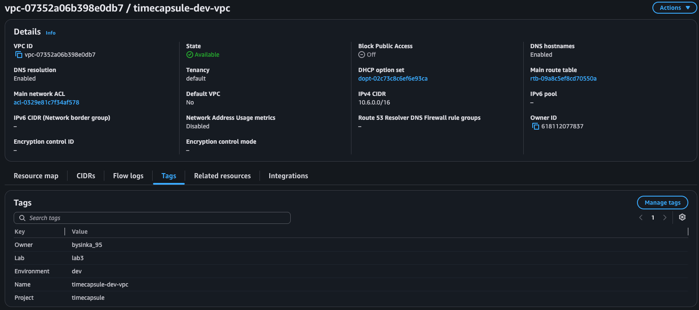

*VPC `timecapsule-dev-vpc` с диапазоном `10.6.0.0/16`, включёнными `DNS resolution` и `DNS hostnames` и пятью обязательными тегами.*

Я создал четыре подсети по плану из задания 1.

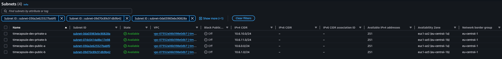

*Четыре подсети в зонах `eu-central-1a` и `eu-central-1b`, в каждой 251 доступный адрес.*

### Задание 3. Internet Gateway и таблицы маршрутов

Я создал Internet Gateway `timecapsule-dev-igw` и подключил его к VPC. Я создал две таблицы маршрутов:

| Таблица      | Маршруты                                                   | Подсети                  |
| ------------ | ---------------------------------------------------------- | ------------------------ |
| `public-rt`  | `10.6.0.0/16` → `local`, `0.0.0.0/0` → `timecapsule-dev-igw` | `public-a`, `public-b`   |
| `private-rt` | `10.6.0.0/16` → `local`                                    | `private-a`, `private-b` |

Для `public-a` и `public-b` я включил автоматическое назначение публичного IPv4-адреса.

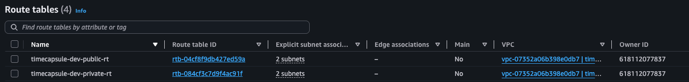

*Таблицы `public-rt` и `private-rt`, каждая связана с двумя подсетями.*

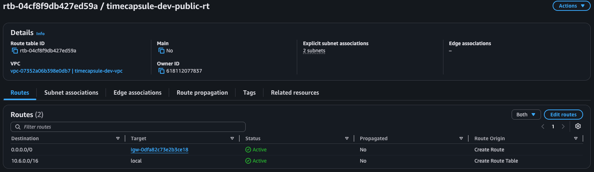

*Маршруты `public-rt`: `0.0.0.0/0` → `timecapsule-dev-igw` и `10.6.0.0/16` → `local`.*

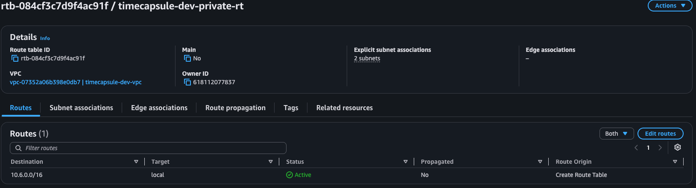

*Маршруты `private-rt`: только `10.6.0.0/16` → `local`.*

### Задание 4. Security Group

Я создал три Security Group в VPC `timecapsule-dev-vpc`. Исходящие правила остались по умолчанию.

| Группа       | Входящее правило  | Источник     |
| ------------ | ----------------- | ------------ |
| `bastion-sg` | SSH (22)          | `My IP`      |
| `web-sg`     | HTTP (80)         | `0.0.0.0/0`  |
| `web-sg`     | SSH (22)          | `bastion-sg` |
| `db-sg`      | PostgreSQL (5432) | `web-sg`     |
| `db-sg`      | SSH (22)          | `bastion-sg` |

Поле `Security group name` не задаёт тег `Name`. Поэтому я добавил тег `Name` и остальные обязательные теги вручную.

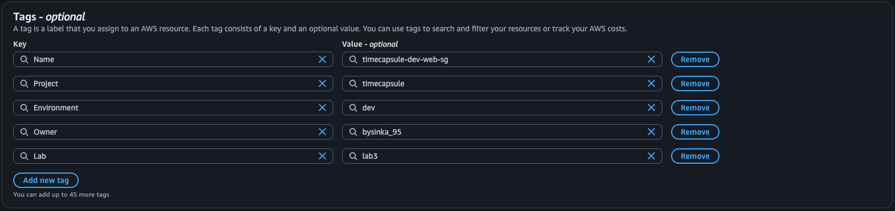

*Обязательные теги группы `timecapsule-dev-web-sg`.*

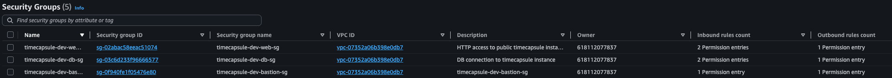

*Три группы в VPC `timecapsule-dev-vpc`: `bastion-sg` с одним входящим правилом, `web-sg` и `db-sg` с двумя.*

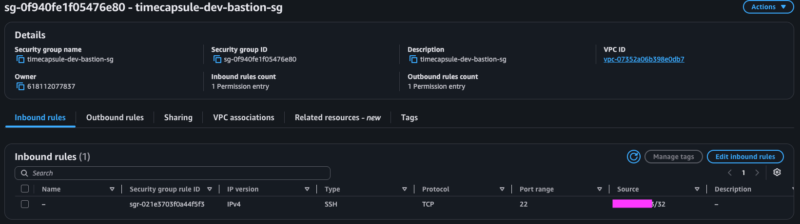

*`bastion-sg`: SSH (22) только с моего адреса `/32`, адрес закрыт.*

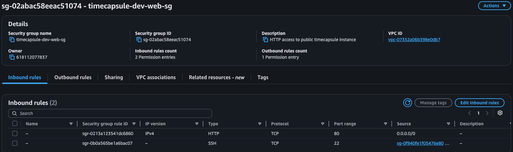

*`web-sg`: HTTP (80) из `0.0.0.0/0` и SSH (22) от группы `bastion-sg`.*

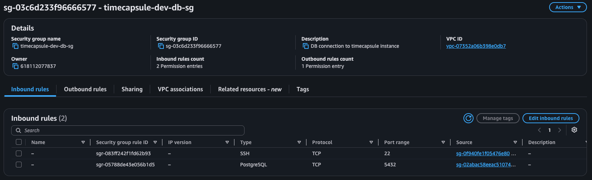

*`db-sg`: SSH (22) от группы `bastion-sg` и PostgreSQL (5432) от группы `web-sg`.*

### Задание 5. Экземпляры

Я запустил три экземпляра `t3.micro` с Amazon Linux 2023:

| Роль         | Имя                       | Подсеть     | Зона            | Приватный IP  | Публичный IP  | Security Group |
| ------------ | ------------------------- | ----------- | --------------- | ------------- | ------------- | -------------- |
| `bastion`    | `timecapsule-dev-bastion` | `public-b`  | `eu-central-1b` | `10.6.1.45`   | `3.75.199.87` | `bastion-sg`   |
| `web-server` | `timecapsule-dev-web`     | `public-a`  | `eu-central-1a` | `10.6.0.104`  | `18.158.60.30`| `web-sg`       |
| `db-server`  | `timecapsule-dev-db`      | `private-a` | `eu-central-1a` | `10.6.10.149` | нет           | `db-sg`        |

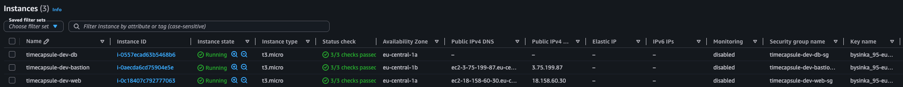

*Три экземпляра в состоянии `Running`, все проверки пройдены, у `db-server` нет публичного адреса.*

Скрипт User data установил на `web-server` nginx и записал на страницу имя сервера и его приватный адрес.

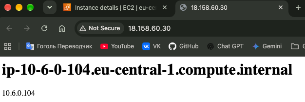

*Страница `web-server` по публичному IP показывает приватный адрес `10.6.0.104` из подсети `public-a`.*

Я описал серверы в файле `~/.ssh/config`. Для `web-server` и `db-server` указан приватный адрес и параметр `ProxyJump` через bastion. Приватный ключ остаётся на моём компьютере.

```text
Host aws-timecapsule-bastion
    HostName 3.75.199.87
    User ec2-user
    IdentityFile ~/.ssh/bysinka_95-keypair.pem

Host aws-timecapsule-web
    HostName 10.6.0.104
    User ec2-user
    IdentityFile ~/.ssh/bysinka_95-keypair.pem
    ProxyJump aws-timecapsule-bastion

Host aws-timecapsule-db
    HostName 10.6.10.149
    User ec2-user
    IdentityFile ~/.ssh/bysinka_95-keypair.pem
    ProxyJump aws-timecapsule-bastion
```

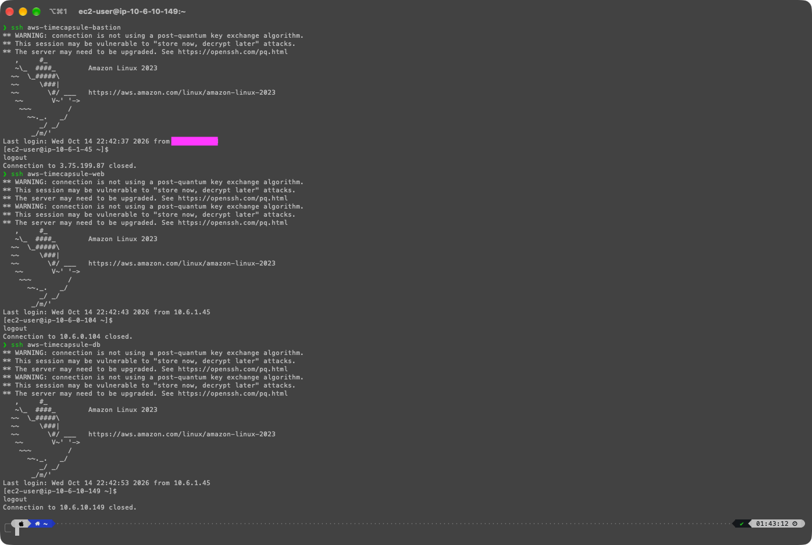

*Подключение к bastion, `web-server` и `db-server`. Вход на `web-server` и `db-server` выполнен с адреса bastion `10.6.1.45`.*

Команда `sudo dnf -y install postgresql16-server` на `db-server` зависла. Я прервал её клавишами `Ctrl+C`. У `db-server` нет маршрута в интернет, поэтому он не может подключиться к репозиторию пакетов.

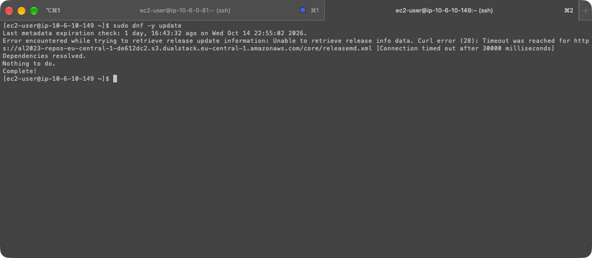

*Повторная проверка 16 октября: без NAT Gateway `dnf` не может подключиться к репозиторию Amazon Linux и завершает запрос по таймауту через 30 секунд.*

### Задание 6. Временный NAT Gateway

Я создал NAT Gateway `timecapsule-dev-nat-a` в подсети `public-a` с новым Elastic IP `63.189.80.251`. Я добавил Elastic IP имя `timecapsule-dev-nat-a-eip` и обязательные теги. Я добавил в `private-rt` маршрут `0.0.0.0/0` → `timecapsule-dev-nat-a`.

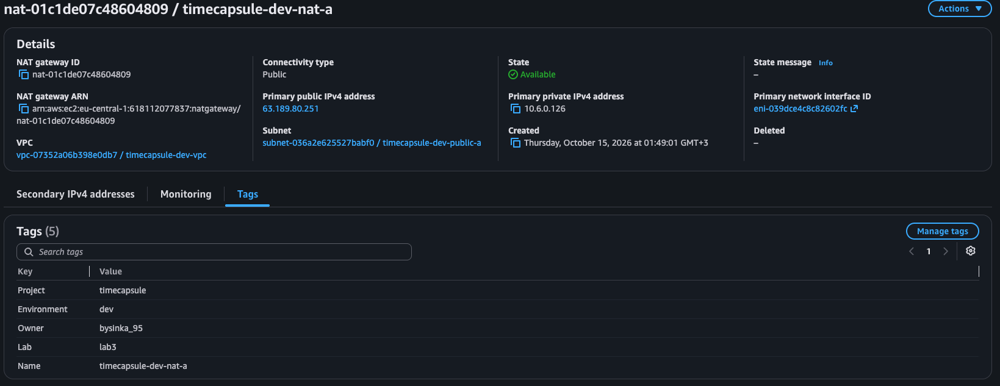

*NAT Gateway `timecapsule-dev-nat-a` в состоянии `Available` в подсети `public-a`.*

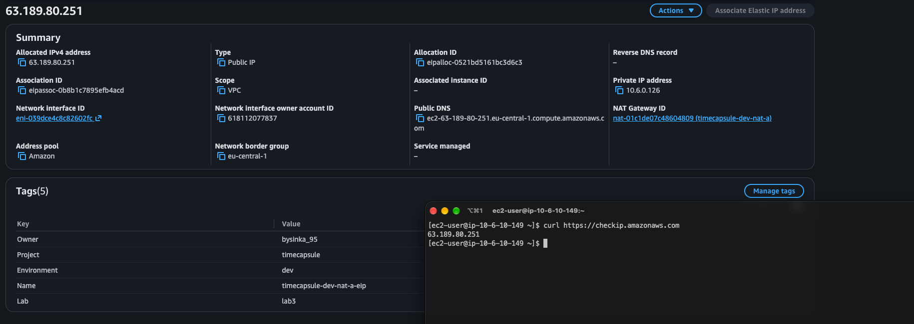

*Elastic IP `63.189.80.251` привязан к NAT Gateway. Команда `curl https://checkip.amazonaws.com` на `db-server` возвращает этот же адрес.*

Через NAT Gateway `db-server` загрузил обновления и установил PostgreSQL 16.

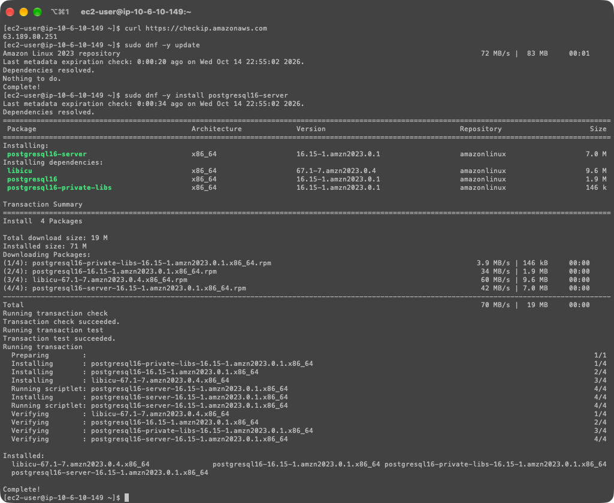

*На `db-server` выполнены `dnf -y update` и установка `postgresql16-server`.*

Я настроил PostgreSQL. Параметр `listen_addresses = '*'` разрешает принимать подключения по сети. Строка в `pg_hba.conf` разрешает вход по паролю только с адресов подсети `public-a`:

```text
host  all  all  10.6.0.0/24  scram-sha-256
```

Я создал пользователя `student` и базу `lab3`.

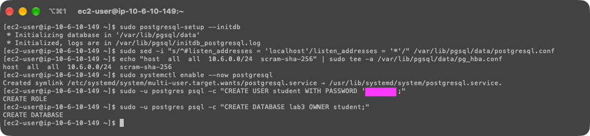

*Инициализация PostgreSQL, настройка сетевого доступа, создание пользователя `student` и базы `lab3`. Пароль закрыт.*

После установки я удалил NAT Gateway, удалил маршрут `0.0.0.0/0` в состоянии `Blackhole` из `private-rt` и освободил Elastic IP `timecapsule-dev-nat-a-eip`. Скриншоты маршрута в состоянии `Blackhole` и шлюза в состоянии `Deleted` сделаны при повторном создании NAT Gateway в задании 13.

### Задание 7. Проверки

**Доступ к базе.** Я установил на `web-server` клиент `postgresql16` и подключился к базе на `db-server` по приватному адресу.


*Запрос `SELECT version()` с `web-server` вернул версию PostgreSQL 16.15.*

**Security Group в действии.** Я проверил порт 5432 на `db-server` с `web-server` и с `bastion`.

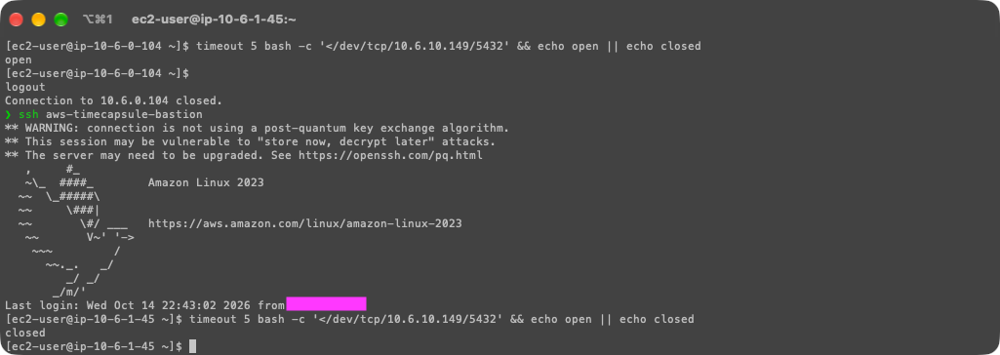

*С `web-server` (`10.6.0.104`) порт 5432 открыт, с `bastion` (`10.6.1.45`) закрыт.*

**Изоляция базы.** После удаления NAT Gateway `db-server` не может подключиться к интернету.


*`curl -m 5 https://github.com` с `db-server` завершается по таймауту.*

**Network ACL.** Я добавил в Network ACL по умолчанию правило `90`: `All traffic` с моего внешнего адреса `/32`, действие `Deny`. SSH на bastion и сайт перестали отвечать. С телефона через мобильный интернет сайт открывался. Затем я удалил правило `90`.

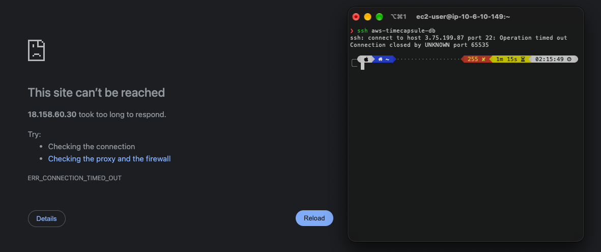

*С правилом `90` сайт и SSH на bastion завершаются по таймауту.*

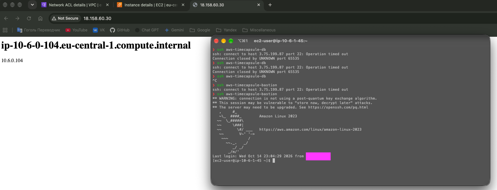

*После удаления правила `90` сайт и SSH на bastion снова работают.*

**Имена и теги.** Я выполнил поиск в `Tag Editor` по тегу `Project` = `timecapsule` в регионе `eu-central-1`.

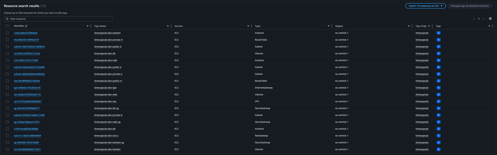

*18 ресурсов с тегом `Project` = `timecapsule`: VPC, 4 подсети, Internet Gateway, 2 таблицы маршрутов, 3 Security Group, 3 экземпляра, 3 диска и NAT Gateway.*

## Часть 2. Продвинутый уровень

### Задание 8. Перенос сервера ЛР2 в новую сеть

Экземпляр нельзя перенести в другую VPC. Поэтому я создал из сервера `webserver` из ЛР2 образ `timecapsule-dev-app-lab2` с обязательными тегами для образа и снимка. Из образа я запустил экземпляр `timecapsule-dev-app` (`app-server`) в подсети `public-a` с группой `web-sg`. User data не нужен: nginx, PHP-FPM и приложение уже есть в образе.

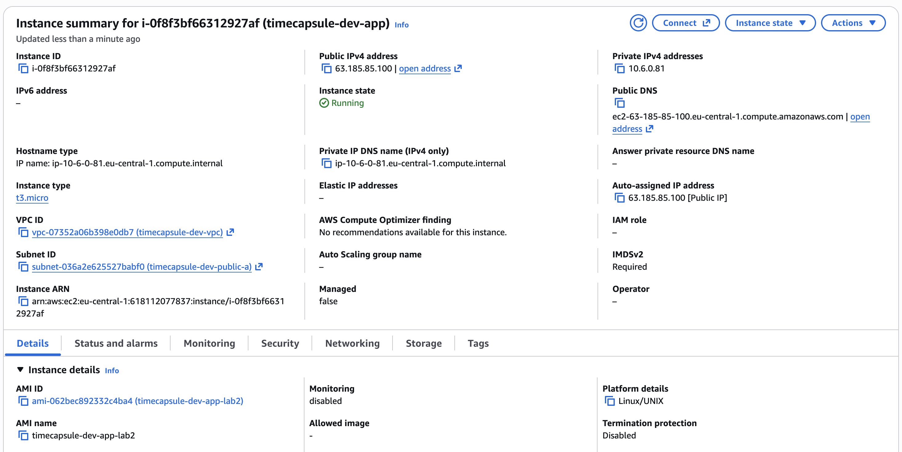

*`timecapsule-dev-app` запущен из образа `timecapsule-dev-app-lab2` в `timecapsule-dev-vpc`, подсеть `public-a`, приватный адрес `10.6.0.81`.*

Я добавил в `~/.ssh/config` запись для `app-server` по образцу `web`:

```text
Host aws-timecapsule-app
    HostName 10.6.0.81
    User ec2-user
    IdentityFile ~/.ssh/bysinka_95-keypair.pem
    ProxyJump aws-timecapsule-bastion
```

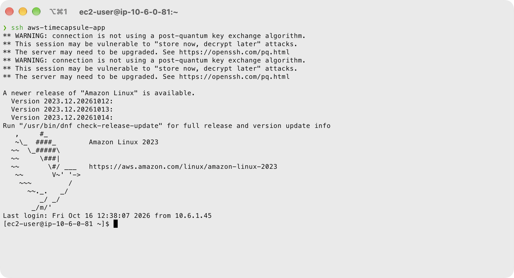

*Подключение к `app-server` через bastion: вход выполнен с адреса `10.6.1.45`.*

### Задание 9. Elastic IP

Я выделил Elastic IP `timecapsule-dev-app-eip` с обязательными тегами и привязал его к `app-server`. Я заменил в `/var/www/timecapsule/.env` значение `APP_URL` на `http://3.71.138.68` и выполнил `sudo systemctl reload php-fpm`. Приложение открывается по Elastic IP (см. скриншот в задании 13).

### Задание 10. База данных приложения на `db-server`

На `db-server` я создал пользователя `timecapsule` с новым паролем и базу `timecapsule`. В `pg_hba.conf` я заменил строку из задания 6 на строку, которая пускает только пользователя `timecapsule` в базу `timecapsule`:

```text
host  timecapsule  timecapsule  10.6.0.0/24  scram-sha-256
```

Затем я перезапустил PostgreSQL командой `sudo systemctl restart postgresql`.

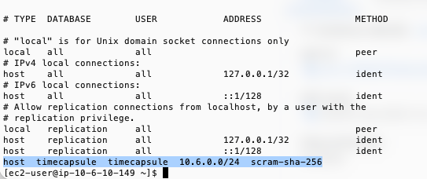

*В `pg_hba.conf` сетевой доступ разрешён только пользователю `timecapsule` к базе `timecapsule` из `10.6.0.0/24`.*

### Задание 11. Приватная зона Route 53

Я создал приватную зону `timecapsule.internal`, связанную с `timecapsule-dev-vpc`, и добавил обязательные теги. В зоне я создал запись `A` `db` → `10.6.10.149` с TTL 60.

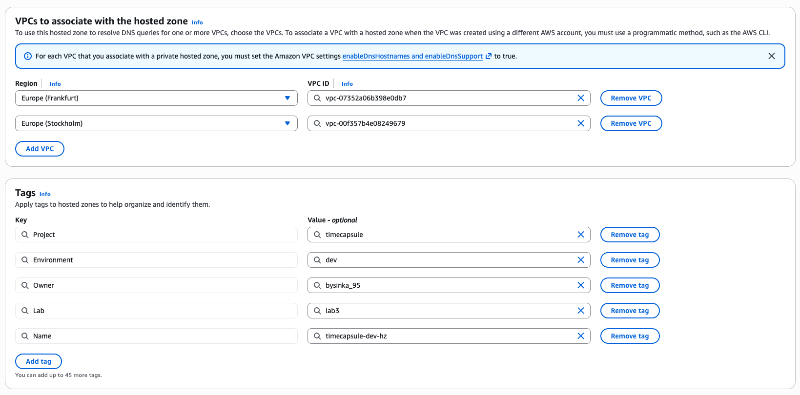

*Создание приватной зоны `timecapsule.internal`: связь с VPC `vpc-07352a06b398e0db7` и обязательные теги.*

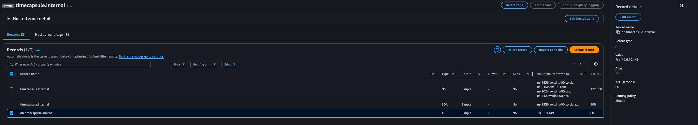

*Запись `A` `db.timecapsule.internal` → `10.6.10.149` с TTL 60 в приватной зоне.*

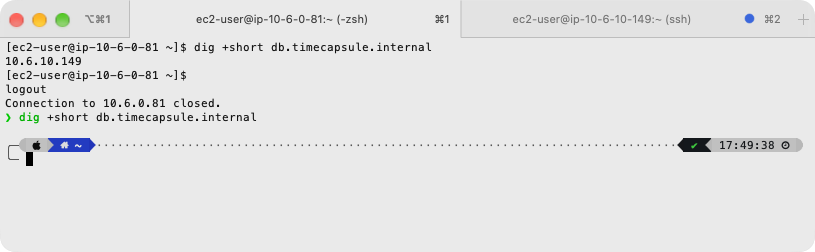

*С `app-server` имя `db.timecapsule.internal` разрешается в `10.6.10.149`, с моего компьютера ответа нет.*

### Задание 12. Перенос данных и переключение приложения

Я выгрузил локальную базу ЛР2 на `app-server` командой `pg_dump` и загрузил её в новую базу на `db-server` по приватной сети:

```bash
pg_dump -h localhost -U timecapsule -d timecapsule -f timecapsule.sql
psql -h db.timecapsule.internal -U timecapsule -d timecapsule -f timecapsule.sql
```

Перед загрузкой дампа на новой базе уже выполнялся `deploy.sh`. Скрипт `init-db.php` создал пустые таблицы, и `psql -f` завершался ошибками `already exists`. Я удалил базу на `db-server` (`DROP DATABASE timecapsule WITH (FORCE)`), создал её заново и повторил загрузку.

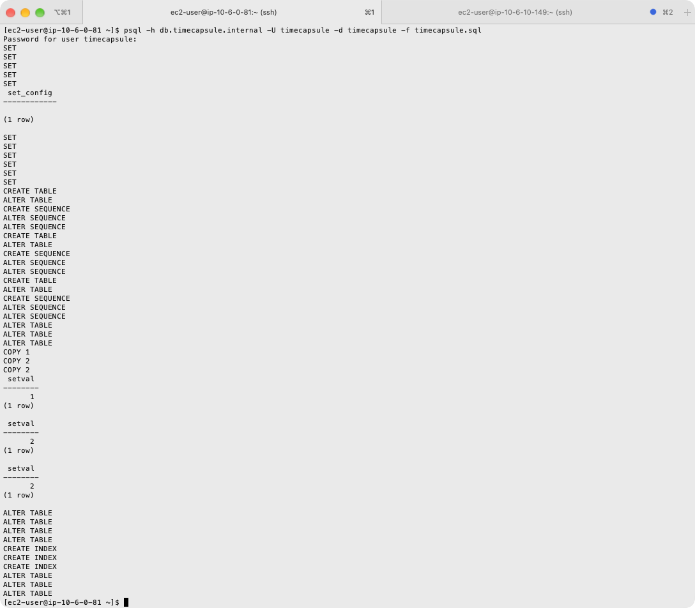

*`psql -f` создал таблицы и загрузил данные: `COPY 1`, `COPY 2`, `COPY 2`.*

Я изменил в `.env` значения `DB_HOST=db.timecapsule.internal` и `DB_PASSWORD`, перезапустил PHP-FPM и выключил локальную базу командой `sudo systemctl disable --now postgresql`.

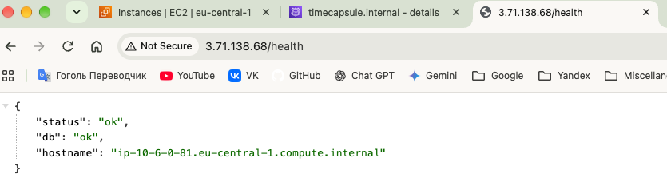

*`/health` по Elastic IP `3.71.138.68` возвращает `"db": "ok"`: приложение работает с базой на `db-server`.*

Капсула из ЛР2 «Test Capsule» осталась на месте (см. скриншот в задании 13).

### Задание 13. Деплой и обслуживание

**Новая версия.** Я добавил в подвал страницы строку «LR3», отправил коммит `Add LR3 to footer` в репозиторий и выполнил деплой через bastion одной командой:

```bash
ssh aws-timecapsule-app ./deploy.sh
```

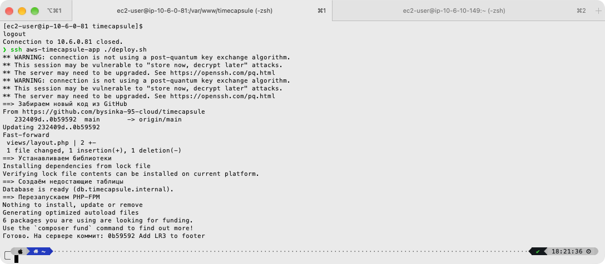

*`deploy.sh` получил коммит `0b59592 Add LR3 to footer`, `init-db.php` подключился к `db.timecapsule.internal`.*

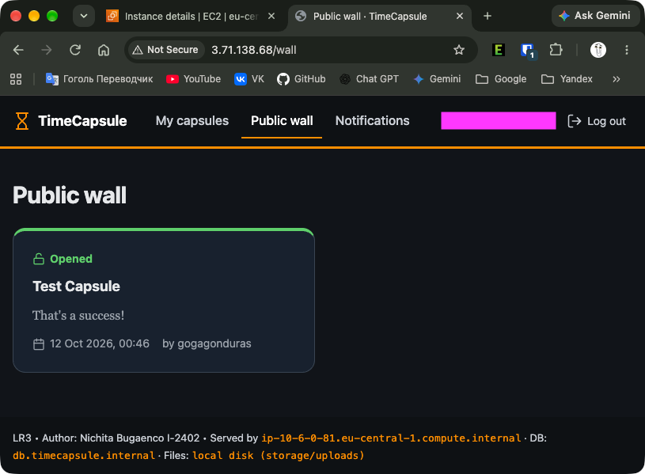

*Приложение по Elastic IP `3.71.138.68`: в подвале строка «LR3» и `DB: db.timecapsule.internal`, капсула «Test Capsule» из ЛР2 на месте.*

**Отказ базы.** Я остановил `db-server` и открыл `/health`. Затем я запустил `db-server` снова. Приложение восстановилось без изменений на `app-server`.

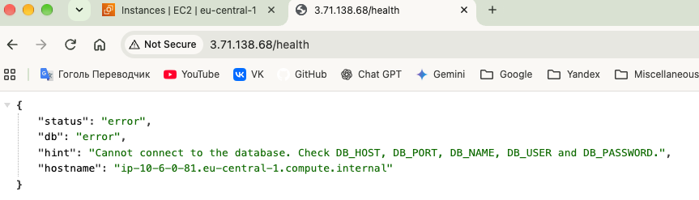

*При остановленном `db-server` `/health` возвращает `"db": "error"` и подсказку проверить настройки подключения.*

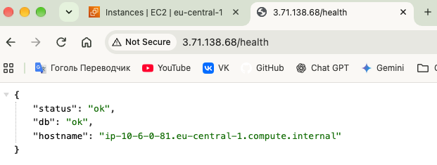

*После запуска `db-server` `/health` снова возвращает `"db": "ok"`.*

**Обновление пакетов на `db-server` (вариант B).** Я написал скрипты `scripts/nat-up.sh` и `scripts/nat-down.sh` на AWS CLI. Идентификаторы подсети `public-a` и таблицы `private-rt` и регион `AWS_REGION=eu-central-1` заданы переменными в начале скриптов. NAT Gateway и Elastic IP получают имена и обязательные теги через `--tag-specifications`. Оба скрипта начинаются с `set -euo pipefail`. Идентификаторы шлюза и адреса `nat-up.sh` сохраняет в файл `scripts/.nat-state`, этот файл добавлен в `.gitignore`. `nat-down.sh` освобождает Elastic IP только после удаления шлюза и повторяет попытку до 6 раз с паузой 20 секунд.

Я запустил скрипты в AWS CloudShell.

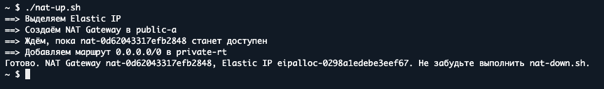

*`nat-up.sh` выделил Elastic IP, создал NAT Gateway `nat-0d62043317efb2848` и добавил маршрут в `private-rt`.*

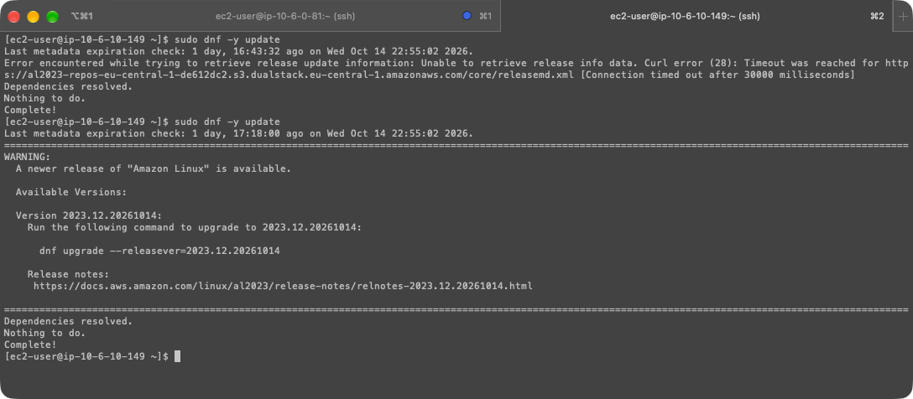

*Первый `dnf -y update` без NAT Gateway завершился таймаутом, второй через NAT Gateway выполнился успешно.*

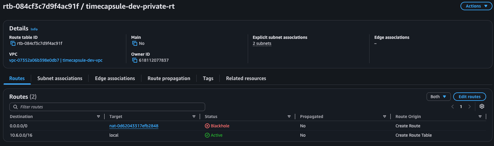

*После удаления NAT Gateway маршрут `0.0.0.0/0` в `private-rt` перешёл в состояние `Blackhole`.*

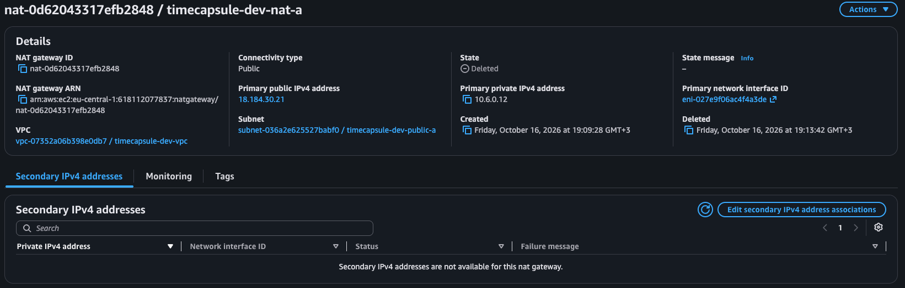

*NAT Gateway `timecapsule-dev-nat-a` в состоянии `Deleted`.*

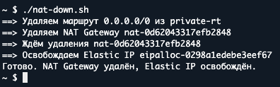

*`nat-down.sh` удалил маршрут и NAT Gateway и освободил Elastic IP.*

### Задание 14. Архитектура и решение

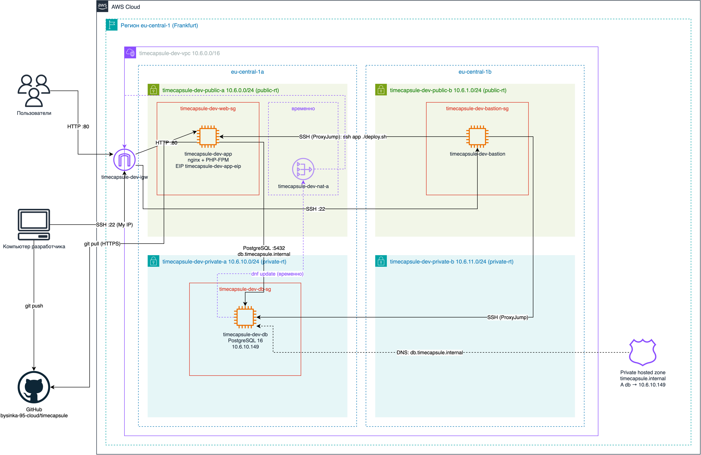

*Схема сети `timecapsule-dev-vpc`: две зоны доступности, четыре подсети, Internet Gateway, три сервера с Security Group, приватная зона Route 53 и временный NAT Gateway (пунктир).*

Пользователи обращаются к `app-server` по HTTP через Internet Gateway. Администратор подключается по SSH только к bastion, а к `app-server` и `db-server` через bastion. `app-server` находит базу по имени `db.timecapsule.internal` и подключается к ней по локальному маршруту VPC. `db-server` выходит в интернет только через временный NAT Gateway.

Архитектурное решение о размещении базы данных записано в ADR: [docs/adr/0002-database-placement.md](../adr/0002-database-placement.md).

## Ответы на контрольные вопросы

### Вопросы из заданий

1. **Почему доступных адресов не 256? Какие адреса подсети `10.X.0.0/24` занимает AWS и для чего? Сколько ещё подсетей `/24` поместится в вашу VPC?**

   AWS резервирует в каждой подсети 5 адресов, поэтому экземплярам доступен 251 адрес из 256. В подсети `10.6.0.0/24` зарезервированы адреса:
   - `10.6.0.0` — адрес сети;
   - `10.6.0.1` — маршрутизатор VPC;
   - `10.6.0.2` — DNS-сервер Amazon (адрес диапазона VPC плюс два);
   - `10.6.0.3` — резерв AWS для будущего использования;
   - `10.6.0.255` — широковещательный адрес. VPC не поддерживает широковещательную рассылку, поэтому AWS резервирует этот адрес.

   В VPC `/16` помещается 2^(24−16) = 256 подсетей `/24`. Четыре подсети уже заняты, поэтому поместится ещё 252 подсети `/24`.

2. **Является ли подсеть `public-a` сейчас публичной? Почему?**

   Нет. Подсеть становится публичной не из-за имени, а из-за маршрута `0.0.0.0/0` в Internet Gateway в её таблице маршрутов. После задания 2 в VPC нет Internet Gateway, и `public-a` использует основную таблицу только с локальным маршрутом. Кроме того, экземпляры в подсети ещё не получают публичный адрес автоматически.

3. **Какой маршрут есть в обеих таблицах, хотя вы его не добавляли? Что он даёт? Куда уйдёт пакет из `private-a`, адресованный `8.8.8.8`?**

   В обеих таблицах есть маршрут `10.6.0.0/16` → `local`. AWS создаёт его автоматически, и его нельзя удалить. Он позволяет всем подсетям VPC обмениваться трафиком, в том числе между зонами доступности. В `private-rt` нет маршрута для `8.8.8.8`, поэтому пакет из `private-a` не будет никуда отправлен: VPC отбросит его.

4. **Почему в `db-sg` источником указана группа `web-sg`, а не адрес веб-сервера или диапазон `10.X.0.0/16`?**

   Правило с источником `web-sg` разрешает доступ каждому экземпляру, к которому подключена группа `web-sg`, независимо от его адреса. Если веб-сервер заменят новым экземпляром с другим адресом или добавят второй веб-сервер, правило не нужно менять. Диапазон `10.6.0.0/16` открыл бы порт 5432 всем серверам VPC, в том числе bastion. Это нарушает принцип минимальных привилегий.

5. **Почему `db-server` не может скачать пакеты, хотя `web-server` это делает? Что нужно добавить в сеть, чтобы это стало возможно, и при этом `db-server` остался недоступным из интернета?**

   У `web-server` есть публичный адрес, а в `public-rt` есть маршрут `0.0.0.0/0` в Internet Gateway. У `db-server` нет публичного адреса, а в `private-rt` есть только локальный маршрут. Нужно создать NAT Gateway в публичной подсети и добавить в `private-rt` маршрут `0.0.0.0/0` в NAT Gateway. NAT Gateway пропускает ответы на исходящие соединения, но не принимает новые соединения из интернета.

6. **Какой адрес вернула первая команда? Сравните его с Elastic IP NAT Gateway. Почему это не адрес `db-server`?**

   Команда вернула `63.189.80.251`. Это Elastic IP NAT Gateway `timecapsule-dev-nat-a-eip`. У `db-server` нет публичного адреса. NAT Gateway заменяет в исходящих пакетах приватный адрес `10.6.10.149` своим публичным адресом. Поэтому внешний сервер видит адрес NAT Gateway.

7. **Доступ к базе ограничивают три механизма: отсутствие публичного адреса и маршрута в Internet Gateway, Security Group `db-sg` и файл `pg_hba.conf`. Что делает каждый из них? Что произойдёт, если ошибиться только в одном?**

   Отсутствие публичного адреса и маршрута не даёт пакетам из интернета дойти до `db-server`. Security Group `db-sg` пропускает порт 5432 только от экземпляров с группой `web-sg`, а SSH только от bastion. Файл `pg_hba.conf` разрешает PostgreSQL вход по паролю только с адресов `10.6.0.0/24`. Механизмы работают независимо друг от друга, это эшелонированная защита. Если ошибиться в одном из них, база остаётся закрытой из интернета, потому что два других механизма продолжают работать. Ошибка в сторону запрета приводит к другой проблеме: веб-сервер не сможет подключиться к базе.

8. **Почему PostgreSQL продолжает работать после удаления NAT Gateway? Что придётся сделать, когда на `db-server` понадобится установить обновления безопасности?**

   NAT Gateway нужен только для исходящих соединений в интернет. Подключения от `web-server` к базе идут внутри VPC по локальному маршруту `10.6.0.0/16`, и NAT Gateway в них не участвует. Для установки обновлений придётся снова создать NAT Gateway, добавить маршрут `0.0.0.0/0` в `private-rt`, выполнить `dnf update`, затем удалить маршрут, шлюз и освободить Elastic IP.

9. **Почему с `web-server` порт открыт, а с `bastion` нет, хотя оба сервера в одной VPC и маршрут между ними есть?**

   Маршрут только определяет путь пакета. Пропустить ли пакет, решает Security Group. Группа `db-sg` разрешает порт 5432 только от экземпляров с группой `web-sg`. У `web-server` есть группа `web-sg`, а у bastion только `bastion-sg`. Поэтому `db-sg` отбрасывает пакеты от bastion.

10. **Почему запрос не проходит? Можно ли из интернета подключиться к порту 5432 `db-server`? Объясните по цепочке из лекции: маршрут, адрес, фильтры.**

    После удаления NAT Gateway в `private-rt` есть только локальный маршрут, поэтому пакеты к `github.com` некуда отправить. Подключиться из интернета к порту 5432 нельзя. Маршрут: в `private-rt` нет маршрута в Internet Gateway, поэтому ответ не может уйти в интернет. Адрес: у `db-server` нет публичного адреса, поэтому из интернета к нему нельзя обратиться. Фильтры: `db-sg` пропускает порт 5432 только от `web-sg`, а `pg_hba.conf` разрешает вход только из `10.6.0.0/24`.

11. **Почему заблокировано и SSH, и сайт, хотя вы не меняли ни одной Security Group? Почему с телефона сайт открывается? Почему правило должно иметь номер меньше 100?**

    Network ACL проверяет весь трафик на границе подсети до Security Group. Все подсети VPC связаны с Network ACL по умолчанию, поэтому правило `Deny` для моего адреса блокирует любой трафик с него к bastion и к `web-server`. Телефон через мобильный интернет использует другой внешний адрес, и правило к нему не применяется. Network ACL проверяет правила по возрастанию номеров и применяет первое подходящее. Правило `100` по умолчанию разрешает весь трафик, поэтому запрет должен иметь меньший номер.

12. **Как по тегам найти все ресурсы, которые нужно удалить после окончания проекта? Зачем нужен тег `Owner`, если аккаунт у вас личный?**

    В `Tag Editor` нужно выполнить поиск по тегам `Project` = `timecapsule` и `Lab` = `lab3` во всех типах ресурсов. В списке будут все ресурсы проекта, которые нужно удалить. Тег `Owner` показывает, кто отвечает за ресурс. В личном аккаунте это привычка, которая пригодится в общем аккаунте команды или организации. Кроме того, по тегу `Owner` скрипты и отчёты о расходах могут группировать ресурсы по владельцу.

13. **Что содержит образ? Какие данные из ЛР2 оказались на `app-server` без всякой установки? Где сейчас хранится база данных приложения?**

    Образ содержит снимок корневого тома EBS и описание для запуска: архитектуру, привязку дисков, права на запуск. На `app-server` без установки оказались Amazon Linux с nginx, PHP-FPM, PostgreSQL и Composer, код в `/var/www/timecapsule` с папкой `vendor/` и файлом `.env`, загруженные файлы в `storage/uploads`, конфигурация nginx и `~/deploy.sh`. База данных после запуска из образа хранится на корневом томе самого `app-server` в `/var/lib/pgsql/data`, как в ЛР2. На `db-server` она переезжает только в задании 12.

14. **Почему Elastic IP нужен `app-server`, но не нужен bastion? Сколько стоит Elastic IP, пока сервер остановлен, и почему? Когда в следующих работах перед сервером появится балансировщик нагрузки, понадобится ли Elastic IP?**

    К `app-server` обращаются пользователи, и его адрес записан в `APP_URL`. Адрес не должен меняться после остановки и запуска. Bastion использует только администратор, и он может обновить строку `HostName` в `~/.ssh/config`. Elastic IP стоит $0,005 в час всегда, даже когда сервер остановлен: адрес IPv4 закреплён за аккаунтом, и никто другой не может его использовать. С балансировщиком нагрузки Elastic IP не понадобится. Пользователи будут обращаться к DNS-имени балансировщика, а `app-server` можно перенести в приватную подсеть.

15. **Зачем для базы в отдельной сети нужен новый сильный пароль, если порт 5432 и так закрыт Security Group?**

    Security Group — только один уровень защиты. Правило можно изменить по ошибке, или злоумышленник может получить доступ к другому серверу с группой `web-sg`. Старый пароль из ЛР2 хранится в образе и снимке диска, в файле `.env` и, возможно, на скриншотах. Поэтому его нельзя считать секретным. Новый сильный пароль защищает базу, если другой уровень защиты не сработал.

16. **Почему с `app-server` имя находится, а с вашего компьютера нет? Что придётся изменить, если `db-server` пересоздадут с другим адресом?**

    Приватная зона отвечает только на запросы к DNS-серверу VPC (`10.6.0.2`) из связанных с ней VPC. `app-server` использует этот DNS-сервер. Мой компьютер использует публичные DNS-серверы, которые не знают зону `timecapsule.internal`. Если `db-server` пересоздадут, нужно изменить только значение записи `A` `db` в зоне. Через 60 секунд (TTL) `app-server` получит новый адрес, `.env` менять не нужно.

17. **Файлы, которые пользователи прикрепили к капсулам, переехали вместе с образом, а не вместе с базой. Где они лежат? Что с ними будет, если `app-server` удалить?**

    Файлы лежат в `/var/www/timecapsule/storage/uploads` на корневом томе EBS `app-server`. У корневого тома включён параметр `DeleteOnTermination`, поэтому при удалении `app-server` файлы будут удалены вместе с томом. База на `db-server` сохранится, но записи капсул будут ссылаться на файлы, которых нет. Чтобы этого избежать, файлы нужно хранить отдельно от сервера, например в Amazon S3, или делать снимки тома.

18. **Почему в самом `deploy.sh` ничего менять не пришлось?**

    Скрипт выполняется на самом `app-server` и не зависит от сети, через которую к серверу подключились. Путь через bastion задаёт `ProxyJump` в `~/.ssh/config` на моём компьютере. Код скрипт берёт из GitHub через Internet Gateway, как и раньше. Адрес базы `init-db.php` читает из `.env`, поэтому новая база используется без изменений в скрипте.

19. **Что показал `/health` и почему? Изменился ли приватный адрес `db-server` после остановки и запуска?**

    При остановленном `db-server` `/health` вернул `"status": "error"` и `"db": "error"`, потому что PHP не смог подключиться к `db.timecapsule.internal:5432`. Ответ пришёл с задержкой: приложение ждало соединения. Приватный адрес не изменился: он закреплён за сетевым интерфейсом экземпляра и сохраняется при остановке и запуске. Поэтому запись `db` осталась верной, и приложение восстановилось само.

20. **Почему `nat-down.sh` должен освобождать Elastic IP только после того, как NAT Gateway удалён?**

    Пока NAT Gateway существует, его сетевой интерфейс использует Elastic IP. AWS не освобождает адрес, который привязан к ресурсу, и `release-address` вернёт ошибку. NAT Gateway удаляется несколько минут и отпускает адрес не сразу после перехода в `Deleted`. Поэтому скрипт ждёт `nat-gateway-deleted` и повторяет попытку освободить адрес.

### Вопросы раздела «Контрольные вопросы»

1. **Как проходит запрос пользователя от браузера до базы данных? Какие маршруты и какие правила фильтрации он проходит на каждом шаге?**

   Браузер отправляет запрос на Elastic IP `3.71.138.68`, порт 80. Internet Gateway заменяет Elastic IP на приватный адрес `10.6.0.81` и передаёт пакет в `public-a`. Network ACL по умолчанию пропускает трафик, `web-sg` пропускает порт 80 из `0.0.0.0/0`. nginx передаёт запрос в PHP-FPM. PHP получает адрес `db.timecapsule.internal` от DNS-сервера VPC (`10.6.0.2`) и подключается к `10.6.10.149:5432` по маршруту `10.6.0.0/16` → `local`. Network ACL пропускает пакет, `db-sg` пропускает порт 5432 от `web-sg`, `pg_hba.conf` пускает пользователя `timecapsule` в базу `timecapsule` из `10.6.0.0/24`. Ответ идёт обратно тем же путём: Security Group пропускает ответы автоматически.

2. **Злоумышленник знает приватный IP `db-server`. Что ему нужно получить, чтобы подключиться к базе?**

   Приватный адрес недоступен из интернета: у `db-server` нет публичного адреса, а в `private-rt` нет маршрута в интернет. Злоумышленнику нужно находиться внутри VPC на сервере с группой `web-sg` и адресом из `10.6.0.0/24`, то есть взломать `app-server`. Кроме этого, ему нужен пароль пользователя `timecapsule`. Другой путь — получить учётные данные AWS и изменить маршруты или Security Group. Поэтому главное — защищать `app-server`, файл `.env` и доступ к аккаунту AWS.

3. **Чем временный NAT Gateway лучше постоянного, и какие неудобства он создаёт?**

   Временный NAT Gateway стоит несколько центов за обновление, а постоянный — около $1,25 в сутки, больше всех остальных ресурсов вместе. Пока шлюза нет, `db-server` не может подключиться к интернету, поэтому вредоносная программа на нём не сможет загрузить код или отправить данные наружу. Неудобства: каждое обновление требует создания шлюза, маршрута и их удаления, это занимает несколько минут. Обновления легко забыть, а забытый шлюз продолжает стоить денег. Скрипты `nat-up.sh` и `nat-down.sh` уменьшают эти неудобства.

4. **Как изменится схема, если приложение должно пережить отказ зоны `eu-central-1a`? Каких ресурсов для этого не хватает?**

   Сейчас `app-server` и `db-server` находятся в `eu-central-1a`, и отказ зоны остановит приложение. Нужен второй `app-server` в `eu-central-1b` и балансировщик нагрузки (Application Load Balancer) в обеих публичных подсетях. Нужна резервная копия базы в `private-b`, которая принимает изменения от основной базы и заменяет её при отказе, например Amazon RDS Multi-AZ. Загруженные файлы нужно хранить в Amazon S3, а не на диске сервера. Для постоянного выхода в интернет нужен NAT Gateway в каждой зоне.

## Вывод

В первой части работы я построил сеть `timecapsule-dev-vpc` с диапазоном `10.6.0.0/16`: две публичные и две приватные подсети в двух зонах доступности. Публичные подсети выходят в интернет через Internet Gateway, приватные подсети имеют только локальный маршрут. Доступ к серверам ограничивают Security Group: SSH открыт только на bastion с моего адреса, порт 5432 базы открыт только для `web-server`. Временный NAT Gateway позволил установить PostgreSQL на `db-server`, после удаления шлюза сервер снова изолирован от интернета. Эксперимент с Network ACL показал, что фильтр на уровне подсети действует до Security Group. Все ресурсы получили имена и теги по соглашению и находятся в `Tag Editor` по тегу `Project`.

Во второй части я перенёс приложение TimeCapsule в новую сеть. Сервер ЛР2 переехал через образ AMI, база данных переехала на `db-server` в приватной подсети через `pg_dump`. Приложение находит базу по имени `db.timecapsule.internal` из приватной зоны Route 53, а пользователи открывают приложение по постоянному Elastic IP. Остановка и запуск `db-server` не потребовали изменений на `app-server`. Временный NAT Gateway для обновлений создаётся и удаляется скриптами AWS CLI. Работа показала, что приватная подсеть и Security Group с источником-группой надёжно закрывают базу. Работа также показала ограничения схемы: все серверы приложения находятся в одной зоне доступности, а загруженные файлы хранятся на диске `app-server`.

## Итог

После завершения работы в аккаунте остался только Elastic IP `app-server`. NAT Gateway удалён, его Elastic IP освобождён.

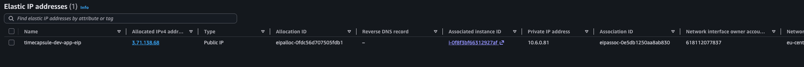

*В списке Elastic IP только `timecapsule-dev-app-eip` (`3.71.138.68`), привязанный к `app-server`.*

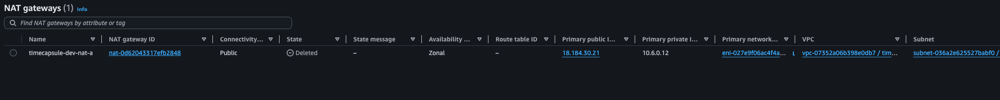

*NAT Gateway `timecapsule-dev-nat-a` в состоянии `Deleted`.*

## Список использованных источников

1. Лекция 5 «Виртуальные сети в облаке. Amazon VPC». Hands-on 5.1.
2. Amazon VPC User Guide: Subnet CIDR blocks. — URL: https://docs.aws.amazon.com/vpc/latest/userguide/subnet-sizing.html
3. Amazon VPC User Guide: Route tables. — URL: https://docs.aws.amazon.com/vpc/latest/userguide/VPC_Route_Tables.html
4. Amazon VPC User Guide: NAT gateways. — URL: https://docs.aws.amazon.com/vpc/latest/userguide/vpc-nat-gateway.html
5. Amazon VPC User Guide: Network ACLs. — URL: https://docs.aws.amazon.com/vpc/latest/userguide/vpc-network-acls.html
6. Amazon EC2 User Guide: Security group rules. — URL: https://docs.aws.amazon.com/AWSEC2/latest/UserGuide/security-group-rules.html
7. PostgreSQL 16 Documentation: The pg_hba.conf File. — URL: https://www.postgresql.org/docs/16/auth-pg-hba-conf.html
8. Tagging AWS resources and Tag Editor. — URL: https://docs.aws.amazon.com/tag-editor/latest/userguide/tagging.html
9. Amazon EC2 User Guide: Amazon Machine Images (AMI). — URL: https://docs.aws.amazon.com/AWSEC2/latest/UserGuide/AMIs.html
10. Amazon EC2 User Guide: Elastic IP addresses. — URL: https://docs.aws.amazon.com/AWSEC2/latest/UserGuide/elastic-ip-addresses-eip.html
11. Amazon Route 53 Developer Guide: Working with private hosted zones. — URL: https://docs.aws.amazon.com/Route53/latest/DeveloperGuide/hosted-zones-private.html
12. PostgreSQL 16 Documentation: pg_dump. — URL: https://www.postgresql.org/docs/16/app-pgdump.html
13. AWS CLI Command Reference: ec2. — URL: https://docs.aws.amazon.com/cli/latest/reference/ec2/
14. Amazon VPC Pricing. — URL: https://aws.amazon.com/vpc/pricing/
