# Лабораторная работа №4. Облачные хранилища. Amazon S3

- **ФИО:** Nichita Bugaenco
- **Группа:** I-2402
- **Специальность:** Informatică
- **Уровень:** продвинутый (Часть 1 и Часть 2, задания 1–14)
- **Репозиторий:** https://github.com/bysinka-95-cloud/timecapsule

## Постановка задачи

Требуется создать бакет Amazon S3 и работать с объектами в консоли и в AWS CLI. Требуется запретить доступ к бакету без HTTPS, включить версионирование, настроить правило жизненного цикла для старых версий и выдать временный доступ к объектам через подписанные URL.

Во второй части требуется перенести вложения приложения TimeCapsule с диска `app-server` в S3. Приложение должно работать с бакетом от имени роли IAM с минимальными правами и выдавать файлы через подписанные URL.

## Цель работы

Получить практические навыки хранения файлов в объектном хранилище Amazon S3: создание бакета и объектов, политики бакета, версионирование, правила жизненного цикла и подписанные URL. Получить навыки настройки политик и ролей IAM для сервера и переноса данных приложения в S3.

## Параметры среды

| Параметр            | Значение                             |
| ------------------- | ------------------------------------ |
| Регион              | `eu-central-1` (Frankfurt)           |
| Бакет               | `timecapsule-dev-uploads-bysinka-95` |
| Правило жизненного цикла | `timecapsule-dev-noncurrent`    |
| Обязательные теги   | `Name`, `Project` = `timecapsule`, `Environment` = `dev`, `Owner` = `bysinka_95`, `Lab` = `lab4` |
| Командная строка    | AWS CloudShell                       |
| Политика IAM        | `timecapsule-dev-app-s3`             |
| Роли IAM            | `timecapsule-dev-s3-tester`, `timecapsule-dev-app-role` |

Имя бакета не может содержать символ `_`, поэтому в имени бакета ник записан как `bysinka-95`.

## Часть 1. Базовый уровень

### Задание 1. Бакет и объекты в консоли

Я создал бакет `timecapsule-dev-uploads-bysinka-95` с параметрами: тип `General purpose`, `ACLs disabled`, `Block all public access`, версионирование выключено, шифрование `SSE-S3`, обязательные теги. Я создал папку `uploads` и загрузил в неё картинку `java-gnom.jpg`. Я создал папку `backups` и загрузил в неё текстовый файл `lab4-task.md`.

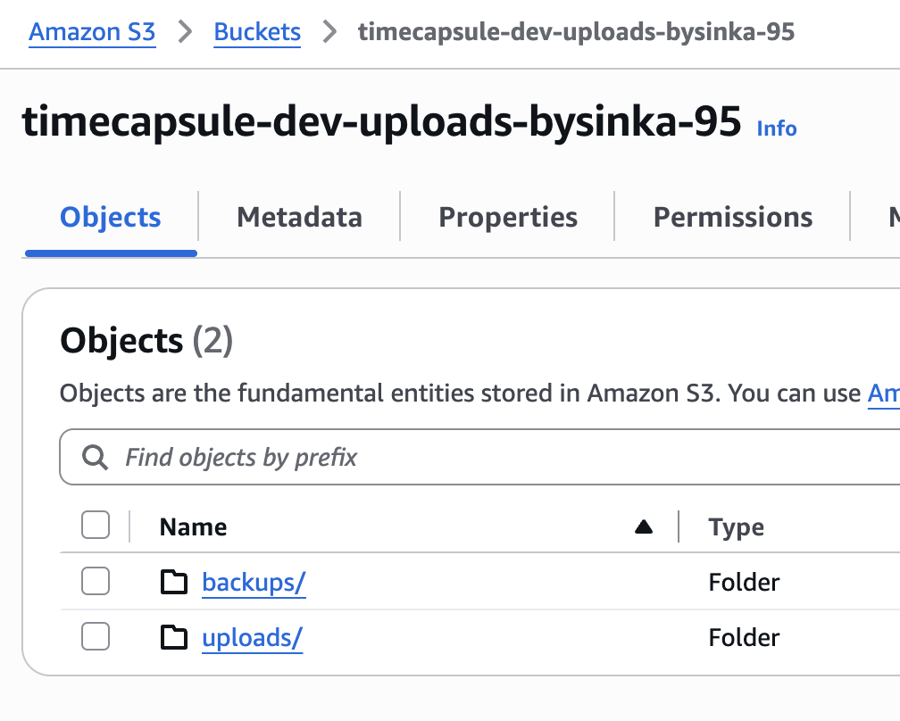

*Бакет `timecapsule-dev-uploads-bysinka-95` с папками `backups/` и `uploads/`.*

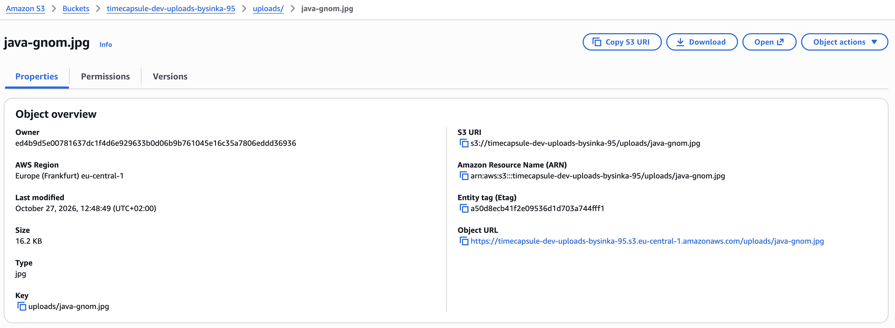

*Свойства объекта: ключ `uploads/java-gnom.jpg`, ETag `a50d8ecb41f2e09536d1d703a744fff1`, `Object URL`. Тип содержимого `image/jpeg` виден в выводе `head-object` в задании 2.*

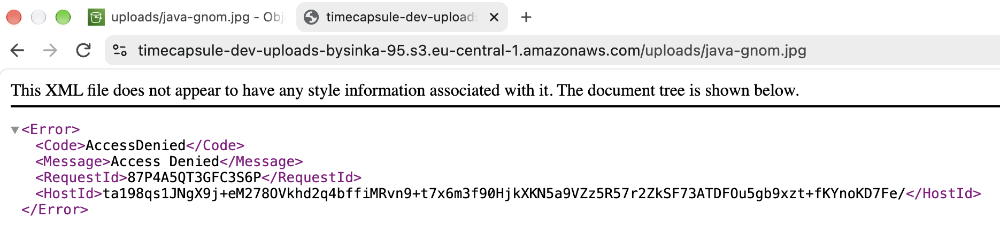

*`Object URL` в браузере возвращает `AccessDenied`.*

### Задание 2. Объекты из командной строки

В CloudShell я создал три файла, загрузил `photo.txt` командой `aws s3 cp` и папку `2026` командой `aws s3 sync`. Затем я посмотрел содержимое бакета тремя способами.

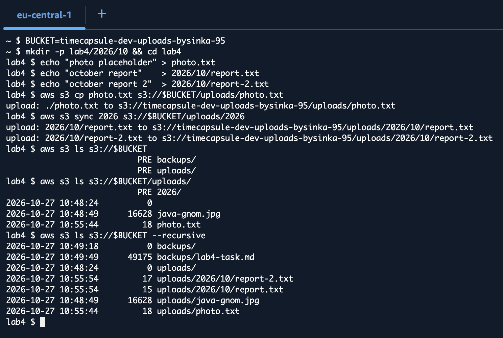

*Загрузка файлов и три команды `aws s3 ls`: корень бакета, префикс `uploads/` и `--recursive`.*

Я прочитал метаданные двух объектов без скачивания:

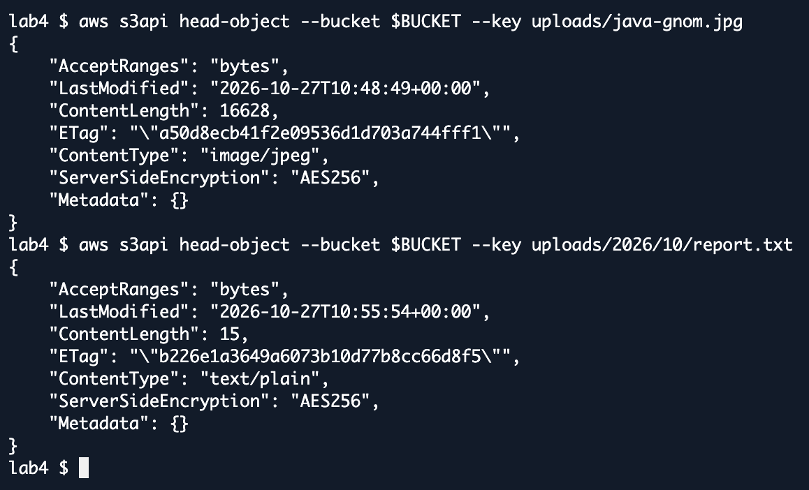

*`head-object`: картинка получила `ContentType` `image/jpeg`, `report.txt` получил `text/plain`. Оба объекта зашифрованы (`AES256`, то есть SSE-S3).*

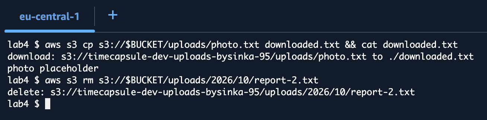

*Скачивание `uploads/photo.txt` и удаление `uploads/2026/10/report-2.txt`.*

### Задание 3. Политика бакета: только HTTPS

Я добавил политику бакета. Она запрещает любому участнику любые действия с бакетом и его объектами, если запрос пришёл не по HTTPS:

```json
{
  "Version": "2012-10-17",
  "Statement": [
    {
      "Sid": "DenyInsecureTransport",
      "Effect": "Deny",
      "Principal": "*",
      "Action": "s3:*",
      "Resource": [
        "arn:aws:s3:::timecapsule-dev-uploads-bysinka-95",
        "arn:aws:s3:::timecapsule-dev-uploads-bysinka-95/*"
      ],
      "Condition": { "Bool": { "aws:SecureTransport": "false" } }
    }
  ]
}
```

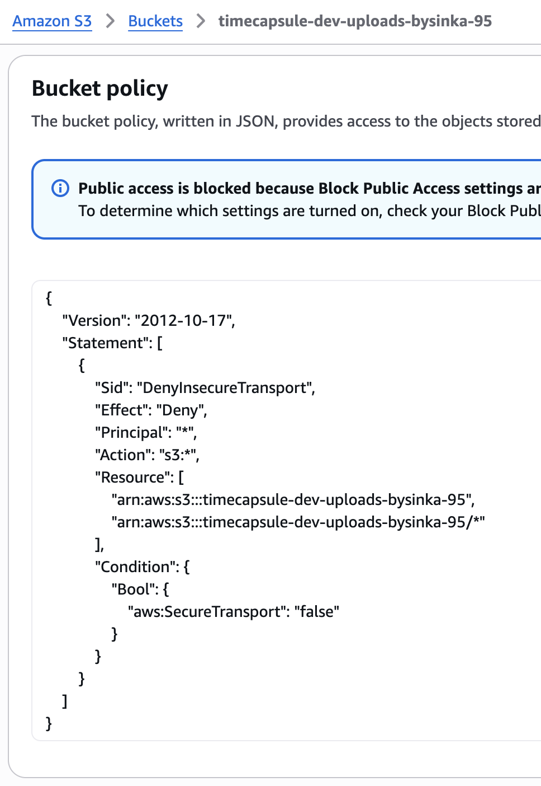

*Сохранённая политика бакета `DenyInsecureTransport`.*

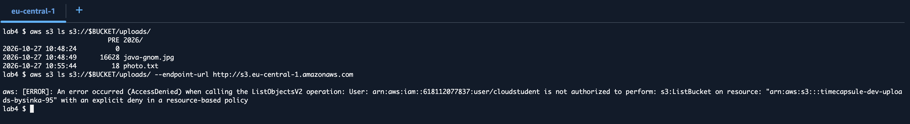

*Запрос по HTTPS возвращает список объектов. Запрос по HTTP получает `AccessDenied` с текстом `explicit deny in a resource-based policy`.*

### Задание 4. Версионирование и защита от удаления

Я включил версионирование бакета. У файлов, загруженных до этого, идентификатор версии `null`. Я загрузил в `uploads/` файл `notes.txt` с текстом `v1`, затем файл с тем же именем и текстом `v2`. Я удалил `notes.txt` при выключенном `Show versions`.

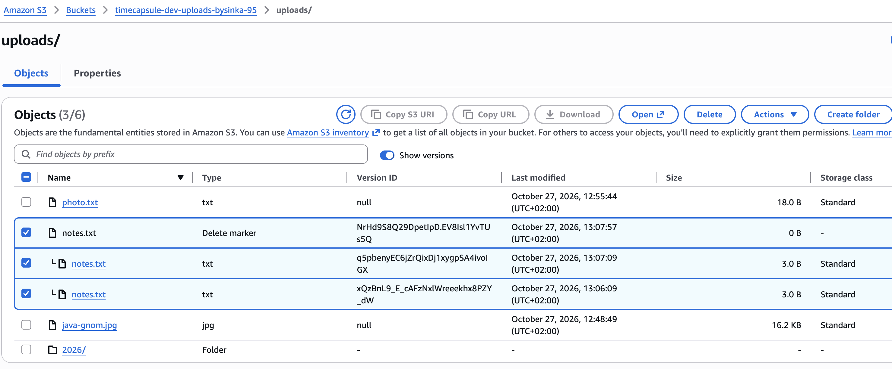

*`Show versions` включён: у `notes.txt` появился `Delete marker`, версии `v2` (13:07:09) и `v1` (13:06:09) сохранились. У файлов, загруженных до включения версионирования, `Version ID` равен `null`.*

Я удалил маркер удаления, и `notes.txt` вернулся с текстом `v2`. Затем я удалил версию `v2`. Консоль попросила ввести `permanently delete`, а не `delete`, как в шаге 3.

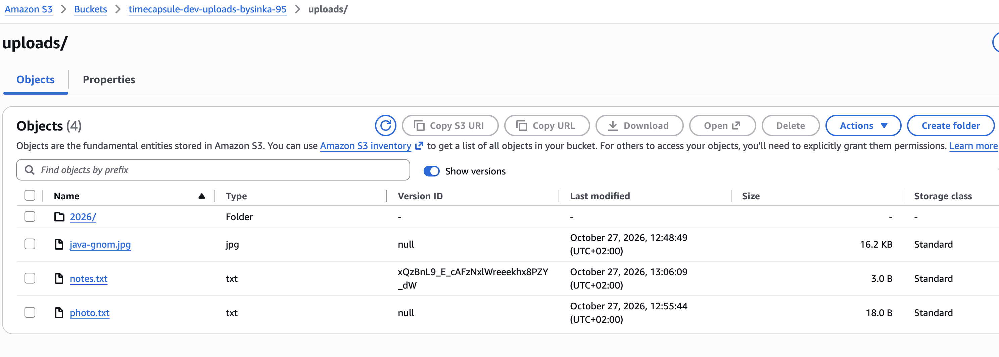

*После удаления версии `v2` у `notes.txt` осталась одна версия `xQzBnL9_…` от 13:06:09, то есть `v1`.*

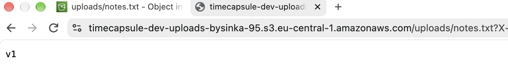

*Текущая версия `notes.txt` содержит текст `v1`.*

### Задание 5. Правило жизненного цикла

Я создал правило `timecapsule-dev-noncurrent` для префикса `uploads/`:

- неактуальные версии переходят в `Standard-IA` через 30 дней;
- неактуальные версии удаляются через 90 дней, кроме двух самых новых;
- незавершённые загрузки частями удаляются через 7 дней.

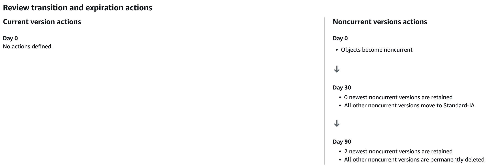

*Блок `Review transition and expiration actions`: переход неактуальных версий в Standard-IA на 30-й день и удаление на 90-й день с сохранением двух новых версий.*

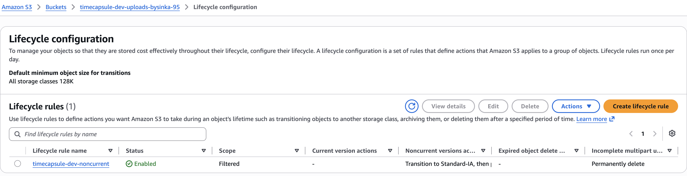

*Правило `timecapsule-dev-noncurrent` включено, область действия `Filtered`, незавершённые загрузки частями удаляются. Минимальный размер объекта для перехода в другой класс хранения — 128 КБ.*

### Задание 6. Подписанные URL

Я создал подписанную ссылку на картинку из консоли на 5 минут и открыл её в приватном окне браузера.

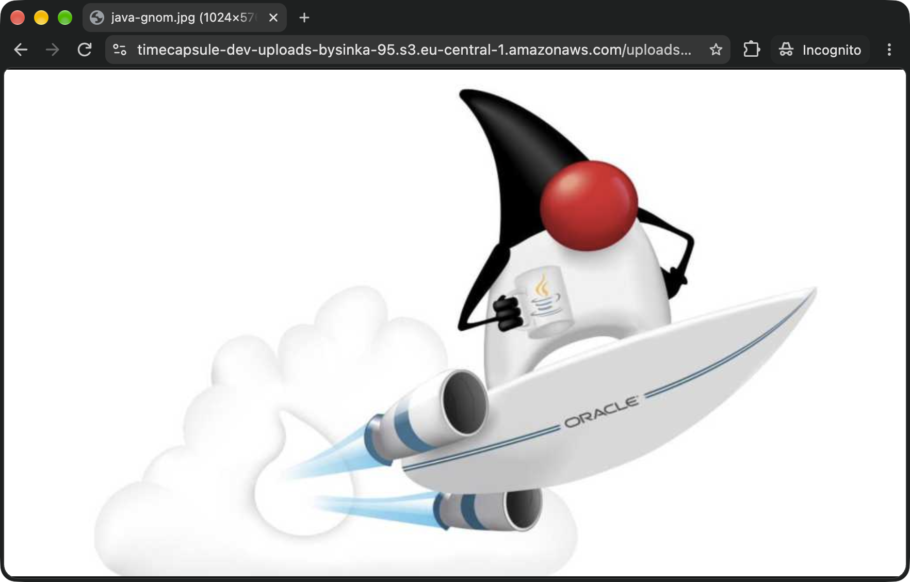

*Картинка открывается по подписанной ссылке в приватном окне.*

Я создал ссылку на `uploads/photo.txt` на 2 минуты командой `aws s3 presign`.

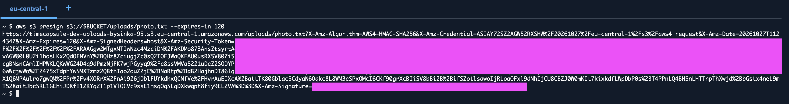

*Подписанная ссылка с параметрами `X-Amz-Algorithm`, `X-Amz-Credential`, `X-Amz-Date`, `X-Amz-Expires=120`. Подпись `X-Amz-Signature` закрыта.*

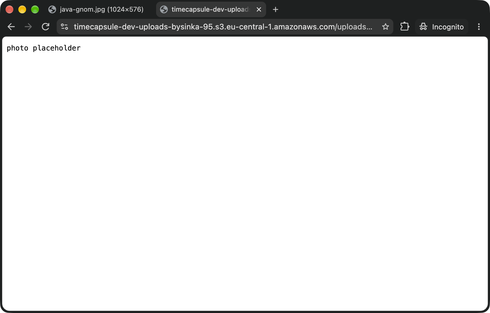

*По ссылке открывается содержимое `photo.txt`: `photo placeholder`.*

Через 2 минуты исходная ссылка перестала работать.

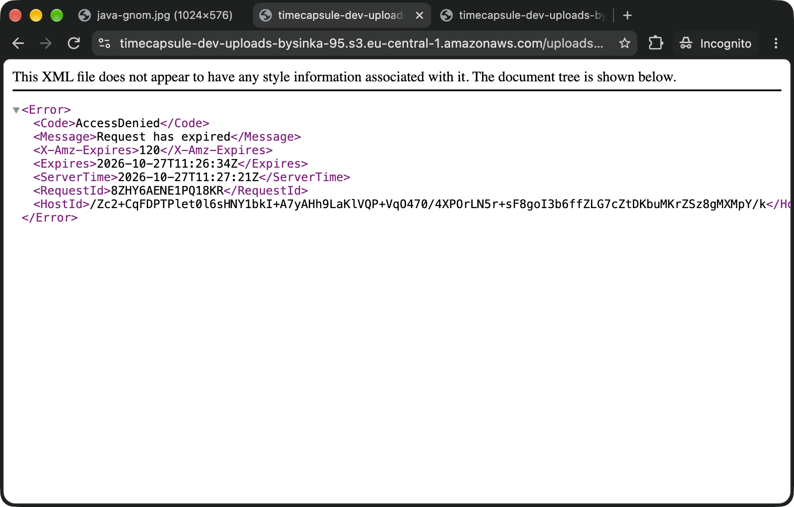

*S3 возвращает `AccessDenied` с текстом `Request has expired`: срок истёк в 11:26:34, запрос пришёл в 11:27:21.*

Я заменил в ссылке `photo.txt` на `notes.txt` и открыл её.

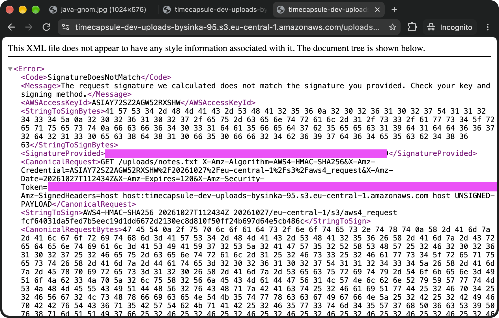

*S3 возвращает `SignatureDoesNotMatch`: подпись не соответствует запросу к `/uploads/notes.txt`. Подпись закрыта.*

После Части 1 я удалил временные файлы в CloudShell командой `cd ~ && rm -rf lab4`.

## Часть 2. Продвинутый уровень

### Задание 7. Политика приложения

Я создал политику IAM `timecapsule-dev-app-s3` с обязательными тегами. Политика разрешает список объектов только под префиксом `uploads/` и чтение, запись и удаление объектов под `uploads/`. Всё остальное запрещено неявно.

```json
{
  "Version": "2012-10-17",
  "Statement": [
    {
      "Sid": "ListUploadsPrefix",
      "Effect": "Allow",
      "Action": "s3:ListBucket",
      "Resource": "arn:aws:s3:::timecapsule-dev-uploads-bysinka-95",
      "Condition": { "StringLike": { "s3:prefix": ["uploads/*"] } }
    },
    {
      "Sid": "ReadWriteUploads",
      "Effect": "Allow",
      "Action": ["s3:GetObject", "s3:PutObject", "s3:DeleteObject"],
      "Resource": "arn:aws:s3:::timecapsule-dev-uploads-bysinka-95/uploads/*"
    }
  ]
}
```

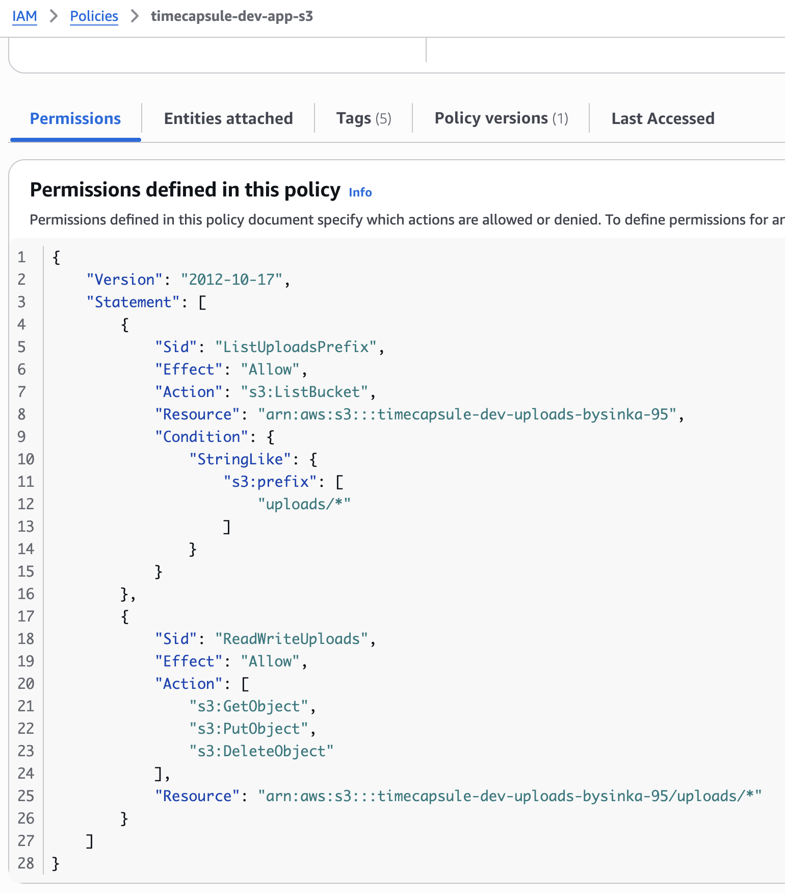

*Политика `timecapsule-dev-app-s3`, версия 1: `s3:ListBucket` с условием `s3:prefix` = `uploads/*` и три действия с объектами `uploads/*`.*

### Задание 8. Проверка прав через тестовую роль

Я создал роль `timecapsule-dev-s3-tester` с доверием к своему аккаунту (`AWS account` → `This account`) и только политикой `timecapsule-dev-app-s3`. Я взял роль на себя в CloudShell командой `aws sts assume-role`.

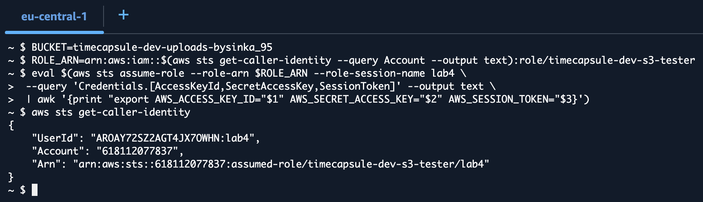

*`aws sts get-caller-identity` от имени роли: `arn:aws:sts::…:assumed-role/timecapsule-dev-s3-tester/lab4`.*

Колонку «Ожидаю» я заполнил до выполнения команд. Все результаты совпали с ожиданием.

| №   | Команда | Ожидаю | Получил | Какое правило сработало |
| --- | ------- | ------ | ------- | ----------------------- |
| 1   | `aws s3 cp test.txt s3://$BUCKET/uploads/test.txt` | разрешено | разрешено | разрешение в политике приложения (`s3:PutObject`) |
| 2   | `aws s3 ls s3://$BUCKET/uploads/` | разрешено | разрешено | разрешение в политике приложения (`s3:ListBucket`, префикс `uploads/`) |
| 3   | `aws s3 ls s3://$BUCKET` | AccessDenied | AccessDenied | неявный запрет (пустой префикс) |
| 4   | `aws s3 cp s3://$BUCKET/uploads/photo.txt -` | разрешено | разрешено | разрешение в политике приложения (`s3:GetObject`) |
| 5   | `aws s3 ls s3://$BUCKET/backups/` | AccessDenied | AccessDenied | неявный запрет (префикс `backups/`) |
| 6   | `aws s3 cp test.txt s3://$BUCKET/backups/test.txt` | AccessDenied | AccessDenied | неявный запрет (`s3:PutObject` вне `uploads/`) |
| 7   | `aws s3api list-object-versions --bucket $BUCKET --prefix uploads/` | AccessDenied | AccessDenied | неявный запрет (`s3:ListBucketVersions`) |
| 8   | `aws s3api delete-object --bucket $BUCKET --key uploads/test.txt --version-id <VersionId>` | AccessDenied | AccessDenied | неявный запрет (`s3:DeleteObjectVersion`) |
| 9   | `aws s3 rm s3://$BUCKET/uploads/test.txt` | разрешено | разрешено | разрешение в политике приложения (`s3:DeleteObject`) |
| 10  | `aws s3 ls s3://$BUCKET/uploads/ --endpoint-url http://s3.eu-central-1.amazonaws.com` | AccessDenied | AccessDenied | явный запрет в политике бакета (`aws:SecureTransport` = `false`) |

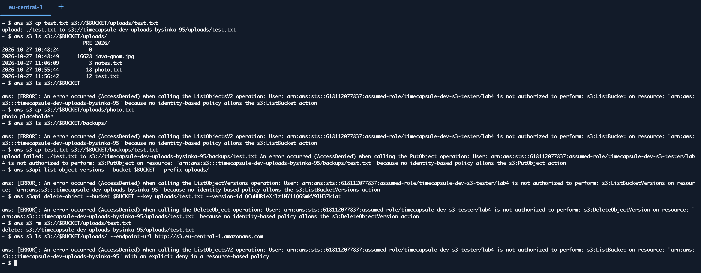

*Вывод десяти команд от имени тестовой роли. Неявный запрет AWS описывает как `no identity-based policy allows`, явный запрет — как `explicit deny in a resource-based policy`.*

После проверки я вернулся к своим правам командой `unset AWS_ACCESS_KEY_ID AWS_SECRET_ACCESS_KEY AWS_SESSION_TOKEN`.

### Задание 9. Роль сервера

Я создал роль `timecapsule-dev-app-role` с доверием к сервису EC2 и только политикой `timecapsule-dev-app-s3` и привязал её к `app-server`.

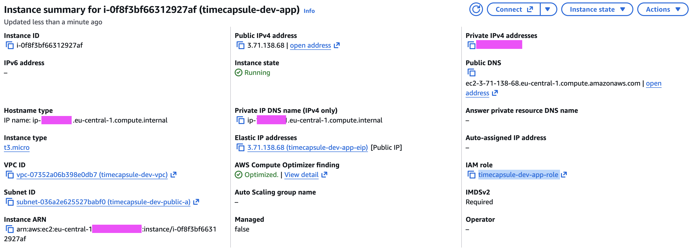

*У `timecapsule-dev-app` в поле `IAM role` указана роль `timecapsule-dev-app-role`.*

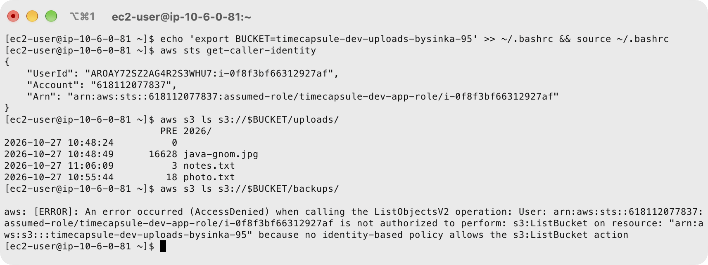

*На `app-server` CLI работает от имени `assumed-role/timecapsule-dev-app-role/i-0f8f3bf66312927af`: префикс `uploads/` доступен, `backups/` получает `AccessDenied`.*

### Задание 10. Перенос существующих файлов

На `app-server` я скопировал вложения из `storage/uploads` в бакет. В нашем деплое нет папки `current`, поэтому команды выполнены в `/var/www/timecapsule`.

```bash
cd /var/www/timecapsule
aws s3 sync storage/uploads s3://$BUCKET/uploads/ --dryrun
aws s3 sync storage/uploads s3://$BUCKET/uploads/
aws s3 sync storage/uploads s3://$BUCKET/uploads/ --dryrun
```

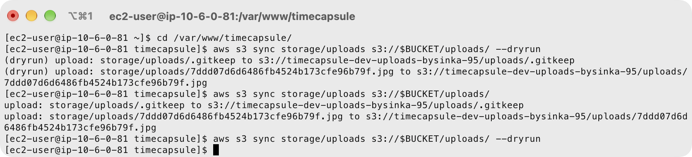

*`sync` скопировал `.gitkeep` и вложение `7ddd07d6…b79f.jpg`. Повторный `--dryrun` ничего не выводит: все файлы уже в бакете.*

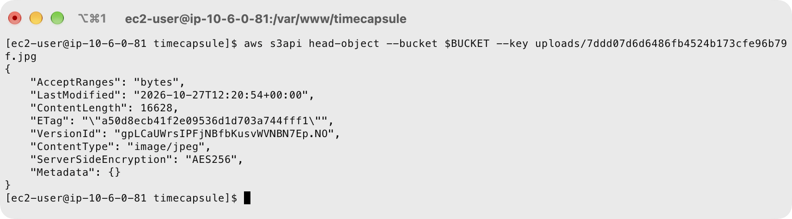

*Перенесённый файл получил `ContentType` `image/jpeg`: AWS CLI определил тип по расширению `.jpg`.*

### Задание 11. Модуль хранения на S3

Я подключил SDK командой `composer require aws/aws-sdk-php` и добавил в `.env.example` и в `.env` на сервере переменные `S3_BUCKET` и `AWS_REGION`. Ключей доступа в `.env` нет: SDK получает временные учётные данные роли сервера.

Я переписал модуль `src/storage.php`:

| Функция | Что делает | Вызов SDK |
| ------- | ---------- | --------- |
| `storage_save()` | Загружает файл под ключом `uploads/<случайное имя>` с `ContentType` из `mime_content_type()` и возвращает случайное имя | `putObject` с `SourceFile` |
| `storage_delete()` | Удаляет объект `uploads/<имя>`. При включённом версионировании создаётся маркер удаления | `deleteObject` |
| `storage_stream()` | Перенаправляет браузер (302) на подписанный URL сроком 5 минут с `ResponseContentType` и `ResponseContentDisposition` (`inline` или `attachment`, исходное имя файла) | `getCommand('GetObject', ...)`, `createPresignedRequest` |

Клиент `S3Client` создаётся один раз на запрос. `basename()` не даёт выйти за пределы префикса `uploads/`. Проверка прав пользователя на капсулу осталась в контроллере и выполняется до вызова `storage_stream()`. В подвале страницы вместо `local disk (storage/uploads)` теперь выводится `s3://timecapsule-dev-uploads-bysinka-95/uploads/`.

Изменения в репозитории: [коммит c8563dc «Add support for S3 storage»](https://github.com/bysinka-95-cloud/timecapsule/commit/c8563dc048f585281ae7696364e12a3fe594aa20).

### Задание 12. Деплой и проверка

Я выпустил новую версию командой `ssh aws-timecapsule-app ./deploy.sh`. Скрипт выполнил `composer install` с новой библиотекой и перезапустил PHP-FPM. Я создал капсулу с картинкой и капсулу с PDF.

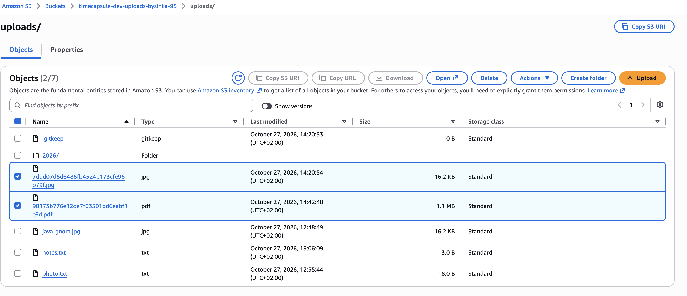

*В `uploads/` появились объекты капсул: перенесённая картинка `7ddd07d6…b79f.jpg` и новый PDF `90173b77…1c6d.pdf`.*

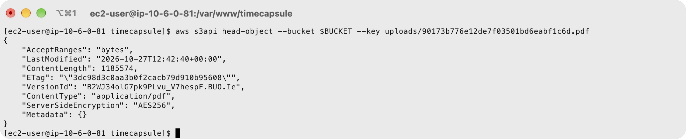

*Объект PDF получил `ContentType` `application/pdf`.*

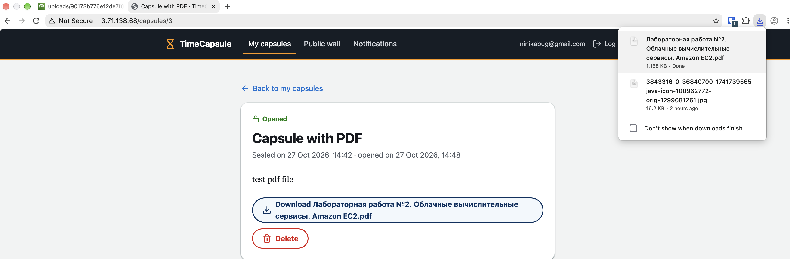

*PDF скачан под исходным именем «Лабораторная работа №2. Облачные вычислительные сервисы. Amazon EC2.pdf».*

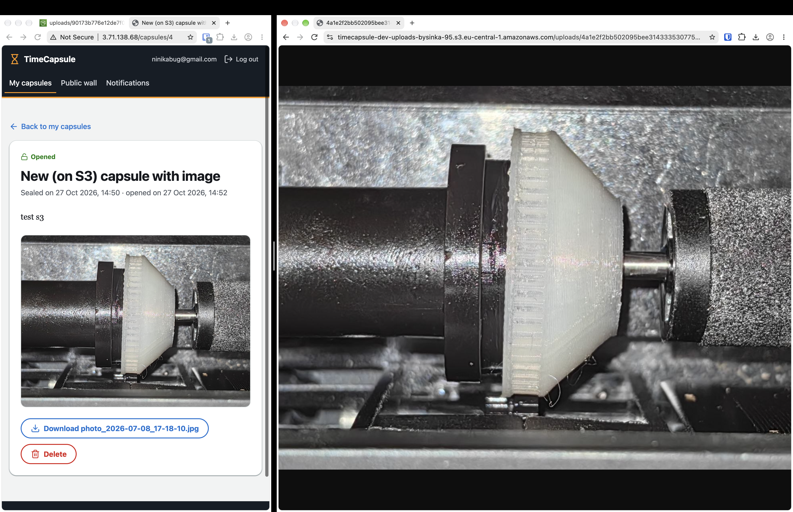

*Картинка новой капсулы открывается по адресу `timecapsule-dev-uploads-bysinka-95.s3.eu-central-1.amazonaws.com/uploads/…`: браузер скачивает её напрямую из S3.*

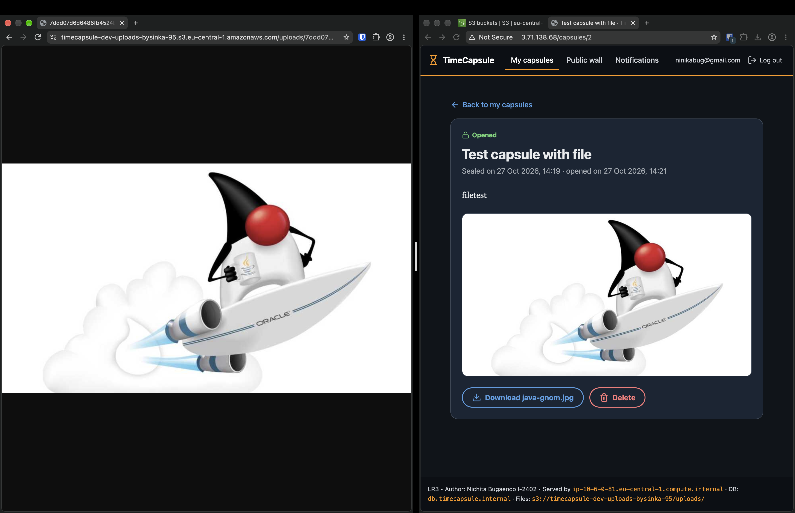

*Капсула «Test capsule with file», созданная до перехода на S3 (файл хранился на диске и перенесён в задании 10). Справа страница капсулы, слева вложение по адресу `timecapsule-dev-uploads-bysinka-95.s3.eu-central-1.amazonaws.com/uploads/7ddd07…`.*

Через 5 минут я открыл ту же ссылку на картинку ещё раз.

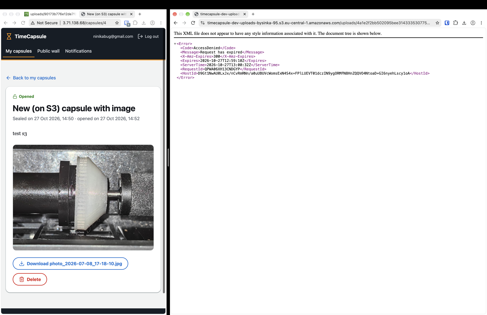

*S3 возвращает `AccessDenied` с текстом `Request has expired`: `X-Amz-Expires` = 300, срок истёк в 12:59:10, запрос пришёл в 13:00:32.*

Я удалил капсулу с картинкой.

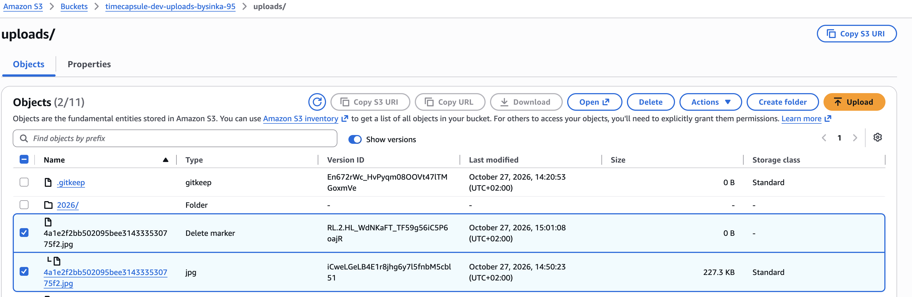

*У объекта удалённой капсулы появился `Delete marker`, версия файла (227,3 КБ) сохранилась.*

### Задание 13. Сервер без состояния

Я переместил папку `storage/uploads` на `app-server` во временное место. Старые и новые капсулы открываются с вложениями. Я создал ещё одну капсулу с вложением, затем удалил копию папки.

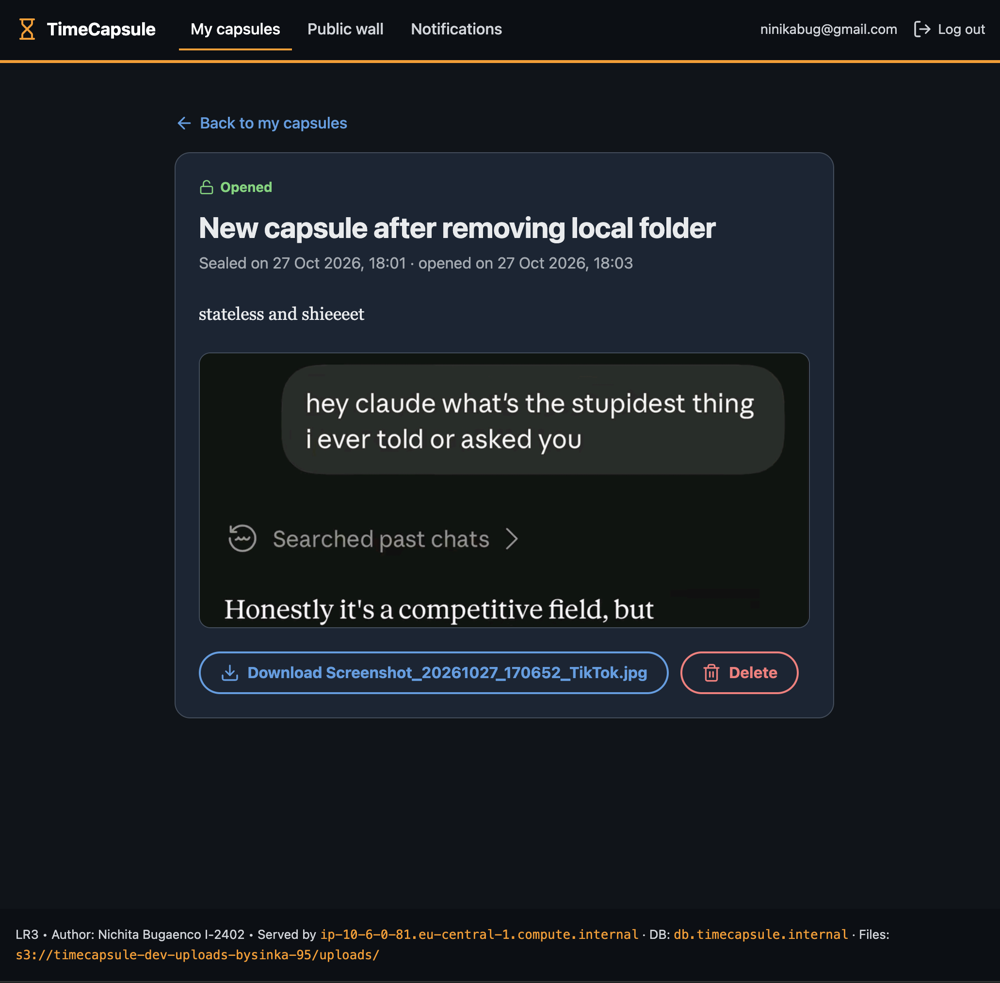

*Новая капсула с вложением после удаления `storage/uploads`. В подвале указано хранилище `s3://timecapsule-dev-uploads-bysinka-95/uploads/`.*

Я создал версию 2 политики `timecapsule-dev-app-s3` без правила `s3:ListBucket`.

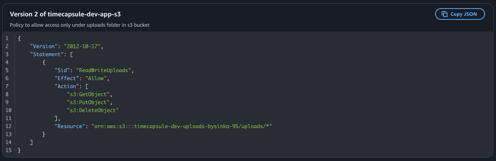

*Версия 2 политики: остались только `s3:GetObject`, `s3:PutObject` и `s3:DeleteObject` для `uploads/*`.*

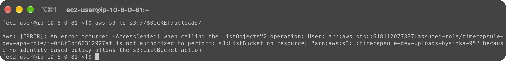

*Приложение продолжает работать, а `aws s3 ls s3://$BUCKET/uploads/` на сервере получает `AccessDenied`.*

Я запросил несуществующий объект на сервере и в CloudShell.

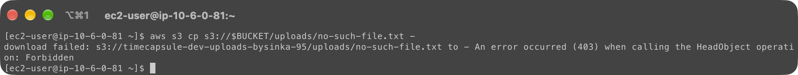

*На сервере S3 возвращает `403 Forbidden`.*

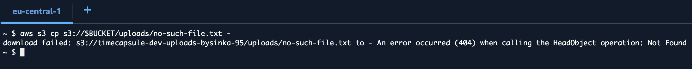

*В CloudShell под моим пользователем S3 возвращает `404 Not Found`.*

### Задание 14. Архитектура и решение

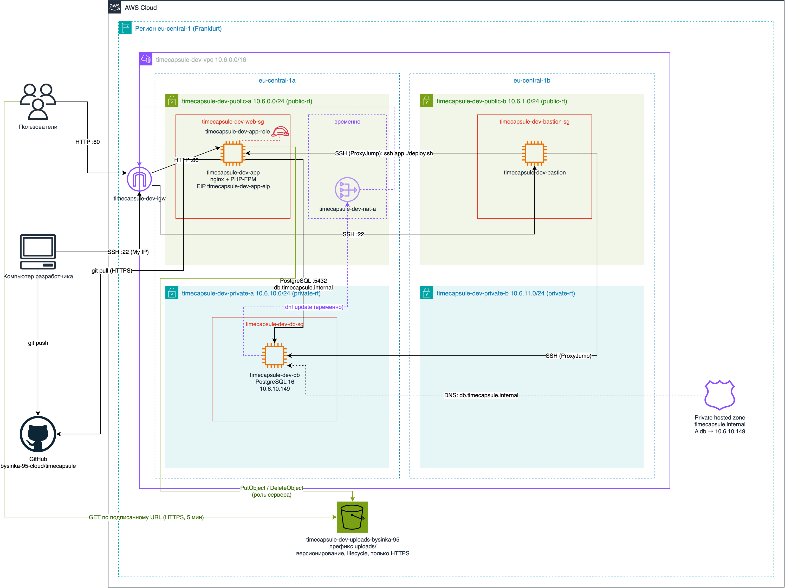

*Схема ЛР3 с бакетом `timecapsule-dev-uploads-bysinka-95` (префикс `uploads/`) в регионе вне VPC, ролью `timecapsule-dev-app-role` у `app-server`, запросами приложения к S3 (`PutObject`, `DeleteObject`) и скачиванием вложений браузером по подписанному URL.*

Архитектурное решение о хранении вложений записано в ADR: [docs/adr/0003-attachment-storage.md](../adr/0003-attachment-storage.md).

## Ответы на контрольные вопросы

### Вопросы из заданий

1. **Какой ключ у картинки? Почему `Object URL` не открывается, хотя вы владелец бакета? Что на самом деле создала кнопка `Create folder`?**

   Ключ картинки — `uploads/java-gnom.jpg`. Браузер отправляет запрос по `Object URL` без подписи, поэтому S3 считает его анонимным. S3 не знает, что запрос отправил владелец. Бакет закрыт настройкой `Block all public access`, и ни одна политика не разрешает анонимное чтение, поэтому S3 возвращает `AccessDenied`. Кнопка `Create folder` создала пустой объект с ключом `uploads/`. В S3 нет настоящих папок, есть только ключи. Этот объект размером 0 байт виден в выводе `aws s3 ls --recursive`.

2. **Почему первая команда `ls` показывает `PRE uploads/` и `PRE backups/`, а третья показывает полные ключи? Какой `Content-Type` получил `report.txt`, хотя вы его не указывали?**

   Без `--recursive` CLI запрашивает список с разделителем `/` и группирует ключи по общему префиксу до первого `/`. Каждую группу CLI показывает строкой `PRE`. С `--recursive` разделитель не используется, и S3 возвращает все ключи целиком. Файл `report.txt` получил `Content-Type` `text/plain`. AWS CLI определяет тип по расширению файла и передаёт его при загрузке.

3. **Почему вторая команда получает `AccessDenied`, хотя у вас права администратора? Почему Block Public Access не помешал сохранить политику с `"Principal": "*"`?**

   AWS проверяет все политики, которые относятся к запросу. Явный запрет (`Deny`) в любой политике важнее любого разрешения (`Allow`). Политика администратора разрешает действие, но политика бакета явно запрещает запросы без HTTPS, поэтому запрос по HTTP отклонён. Block Public Access запрещает политики, которые дают публичный доступ, то есть `Allow` для `"Principal": "*"`. Наша политика ничего не разрешает, а только запрещает, поэтому публичного доступа она не создаёт.

4. **Чем удаление в шаге 3 отличается от удаления в шаге 5? Какое из них можно отменить? Какой из двух способов защищает от случайного удаления, а какой нужно запрещать приложению?**

   В шаге 3 удаление без идентификатора версии создало маркер удаления. Маркер стал текущей версией, а все версии файла сохранились. Это удаление можно отменить: достаточно удалить маркер. В шаге 5 удаление указанной версии стёрло её навсегда, отменить его нельзя. Маркер удаления защищает от случайного удаления. Удаление версий (`s3:DeleteObjectVersion`) нужно запрещать приложению.

5. **Как поведёт себя правило для файла, который перезаписывали 10 раз за неделю? Какие версии и когда окажутся в Standard-IA, какие будут удалены? Почему наши маленькие тестовые файлы в Standard-IA не попадут? Что такое незавершённая загрузка частями и почему за неё приходится платить?**

   У файла будет 1 текущая версия и 9 неактуальных. Правило не трогает текущую версию. Каждая неактуальная версия переходит в Standard-IA через 30 дней после того, как стала неактуальной. Через 90 дней после этого 7 старых неактуальных версий будут удалены, а 2 самые новые неактуальные версии останутся. Маленькие файлы не попадут в Standard-IA, потому что по умолчанию S3 не переводит в другой класс объекты меньше 128 КБ: Standard-IA берёт плату минимум за 128 КБ, и переход стоил бы дороже хранения. Загрузка частями (multipart upload) передаёт большой файл по частям. Если загрузку не завершили и не отменили, части остаются в бакете и оплачиваются как хранение, хотя в списке объектов их не видно.

6. **Какие ошибки вернул S3 в шагах 3 и 4? Почему нельзя получить другой файл, просто поменяв ключ в ссылке? Обращалась ли команда `aws s3 presign` к S3, когда создавала ссылку?**

   В шаге 3 S3 вернул `SignatureDoesNotMatch`, в шаге 4 — `AccessDenied` с текстом `Request has expired`. Подпись вычисляется из метода, пути к объекту, параметров запроса и срока действия с помощью секретного ключа. Если изменить ключ объекта, S3 вычисляет другую подпись, и она не совпадает с подписью в ссылке. Создать правильную подпись без секретного ключа нельзя. Команда `aws s3 presign` не обращалась к S3: она вычислила подпись локально из учётных данных CloudShell. S3 проверяет подпись только тогда, когда по ссылке приходит запрос.

7. **Почему `s3:ListBucket` относится к ресурсу «бакет», а `s3:GetObject` к ресурсу «объект»? Что произойдёт, если перепутать ARN в этих двух правилах?**

   Список объектов — это операция с бакетом целиком, поэтому AWS проверяет её по ARN бакета `arn:aws:s3:::имя`. Чтение — это операция с одним объектом, поэтому AWS проверяет её по ARN объекта `arn:aws:s3:::имя/ключ`. Если перепутать ARN, ни одно правило не совпадёт с запросом. Политика сохранится, но не даст никаких прав: и список, и чтение получат `AccessDenied`.

8. **Чем политика доверия роли отличается от политики прав? Что на самом деле произошло с `test.txt` после команды 9, и можно ли его восстановить? Сможет ли злоумышленник, получивший учётные данные приложения, уничтожить файлы пользователей без возможности восстановления? А если бы в политике было `"s3:*"`?**

   Политика доверия определяет, кто может взять роль на себя (`sts:AssumeRole`). Политика прав определяет, что можно делать с этой ролью. После команды 9 S3 создал маркер удаления, а версия `test.txt` сохранилась как неактуальная. Файл можно восстановить, если удалить маркер пользователем с правом `s3:DeleteObjectVersion`. Злоумышленник с правами приложения может удалять и перезаписывать файлы, но не может удалить версии, поэтому файлы можно восстановить. Восстанавливать нужно не позже чем через 90 дней: потом правило жизненного цикла удаляет старые версии. С `"s3:*"` злоумышленник смог бы удалить все версии, приостановить версионирование, изменить политику бакета и удалить бакет.

9. **Где AWS CLI на сервере взял учётные данные, если вы не выполняли `aws configure` и не вызывали `assume-role`? Чем политика доверия этой роли отличается от тестовой? Почему такие учётные данные безопаснее ключа доступа в файле `.env`?**

   CLI получил временные учётные данные роли из сервиса метаданных экземпляра (IMDSv2, адрес `169.254.169.254`). EC2 выдаёт их через профиль экземпляра и автоматически обновляет. Тестовая роль доверяет моему аккаунту, то есть её может взять пользователь IAM. Роль сервера доверяет только сервису `ec2.amazonaws.com`. Временные учётные данные действуют несколько часов и автоматически заменяются. Они не хранятся в файлах, не попадают в репозиторий, образ AMI или резервные копии и доступны только изнутри экземпляра.

10. **Хватило ли для `aws s3 sync` прав политики приложения? Какие из разрешённых действий использовала команда?**

    Да, прав хватило. `sync` сначала получил список объектов под `uploads/` (`s3:ListBucket` с префиксом `uploads/`), чтобы найти файлы, которых нет в бакете. Затем он загрузил отсутствующие файлы (`s3:PutObject`). Действия `s3:GetObject` и `s3:DeleteObject` команда не использовала.

11. **Почему ссылку, которую пользователь переслал другу, не нужно специально отзывать? Что осталось в бакете после удаления капсулы и когда это исчезнет окончательно?**

    Подписанная ссылка действует 5 минут, а срок входит в подпись, поэтому продлить его нельзя. Кроме того, ссылка подписана временными учётными данными роли и перестаёт работать, когда они истекают. После удаления капсулы в бакете остались маркер удаления и неактуальная версия файла. Через 30 дней версия перейдёт в Standard-IA. Правило удаляет неактуальные версии через 90 дней, но сохраняет две самые новые. У этого файла неактуальная версия одна, поэтому правило её не удалит, и маркер удаления тоже останется. Удалить их окончательно можно только вручную или отдельным правилом.

12. **Почему S3 ответил вам и серверу по-разному, хотя объекта нет в обоих случаях? Зачем S3 так поступает? Что теперь нужно сделать, чтобы заменить `app-server` новым сервером без потери данных?**

    S3 возвращает `404 Not Found` только тому, у кого есть право `s3:ListBucket` на бакет. У моего пользователя это право есть. У роли сервера после задания 13 его нет, поэтому S3 вернул `403 Forbidden`. Так S3 не сообщает, существует ли объект, тому, кому не разрешено видеть список объектов: злоумышленник не может перебором узнать имена файлов. Чтобы заменить `app-server`, на новом сервере нужны код из репозитория, файл `.env` и роль `timecapsule-dev-app-role`. Затем нужно перенести на него Elastic IP. Данные пользователей хранятся в базе на `db-server` и в бакете S3, поэтому на старом сервере ничего не теряется.

### Вопросы раздела «Контрольные вопросы»

1. **Как проходит запрос на скачивание вложения: от нажатия ссылки в браузере до получения файла? Где на этом пути проверяются права пользователя приложения, а где права роли?**

   Браузер отправляет запрос `/capsules/{id}/file` на Elastic IP, nginx передаёт его в PHP-FPM. Приложение проверяет сессию и права пользователя: капсула должна быть открыта и видна этому пользователю. Затем приложение подписывает URL учётными данными роли (без запроса к S3) и отвечает кодом 302. Браузер отправляет запрос в S3 по HTTPS. S3 проверяет подпись и срок ссылки, права роли (`s3:GetObject` на `uploads/*`) и политику бакета (только HTTPS), затем отдаёт файл с заданными заголовками.

2. **Какие настройки бакета и какие свойства подписанного URL не дают постороннему открыть вложение по прямому адресу объекта?**

   Бакет закрыт настройкой `Block all public access`, ACL отключены, и ни одна политика не разрешает анонимное чтение. Поэтому запрос по `Object URL` без подписи получает `AccessDenied`. Подписанный URL действует только для одного ключа и метода `GET`, его срок — 5 минут, и изменить ссылку без секретного ключа нельзя. Имена файлов случайные (32 шестнадцатеричных символа), поэтому угадать ключ невозможно.

3. **Почему приложение отдаёт файлы через подписанный URL, а не открывает бакет для чтения всем?**

   Если открыть бакет для чтения всем, любой, кто знает или получит ключ объекта, сможет скачать файл в любой момент. Приложение не сможет проверить, открыта ли капсула и кому она принадлежит, и не сможет отозвать доступ. Подписанный URL выдаётся только после проверки прав в приложении и быстро истекает, а бакет остаётся закрытым. При этом файл всё равно скачивается напрямую из S3 и не нагружает сервер.

4. **Как изменится схема, если вложения должны пережить отказ всего региона `eu-central-1`?**

   Нужен второй бакет в другом регионе, например `eu-west-1`, с включённым версионированием и правило Cross-Region Replication, которое копирует в него новые объекты. Для репликации нужна отдельная роль IAM. Приложение в резервном регионе должно уметь подписывать ссылки на резервный бакет. Кроме того, во втором регионе нужны серверы приложения, копия базы данных и переключение DNS (Route 53 failover), иначе вложения сохранятся, но приложение будет недоступно.

## Вывод

В ходе работы я создал закрытый бакет S3 с шифрованием SSE-S3 и работал с объектами в консоли и в AWS CLI. Работа показала, что в S3 нет папок: ключ объекта — это полный путь, а «папки» — это общие префиксы. Политика бакета с явным запретом заставляет всех клиентов, включая администратора, использовать HTTPS. Версионирование защищает от случайного удаления маркером удаления, а правило жизненного цикла ограничивает рост истории версий. Подписанные URL дают временный доступ к одному объекту, и изменить такую ссылку на другой объект нельзя.

Во второй части я перенёс вложения приложения TimeCapsule с диска `app-server` в бакет S3. Приложение работает с бакетом от имени роли `timecapsule-dev-app-role` с минимальной политикой: без ключей доступа, без права удалять версии и, после задания 13, без права получать список объектов. Браузер получает файлы напрямую из S3 по подписанным URL сроком 5 минут, а права пользователя проверяет приложение. После удаления папки `storage/uploads` приложение продолжило работать: сервер больше не хранит данные пользователей, и его можно заменить новым без потери данных.

## Список использованных источников

1. Лекция «Облачные хранилища. Amazon S3».
2. Amazon S3 User Guide: Organizing objects using prefixes. — URL: https://docs.aws.amazon.com/AmazonS3/latest/userguide/using-prefixes.html
3. Amazon S3 User Guide: Blocking public access to your Amazon S3 storage. — URL: https://docs.aws.amazon.com/AmazonS3/latest/userguide/access-control-block-public-access.html
4. Amazon S3 User Guide: Retaining multiple versions of objects with S3 Versioning. — URL: https://docs.aws.amazon.com/AmazonS3/latest/userguide/Versioning.html
5. Amazon S3 User Guide: Managing the lifecycle of objects. — URL: https://docs.aws.amazon.com/AmazonS3/latest/userguide/object-lifecycle-mgmt.html
6. Amazon S3 User Guide: Sharing objects with presigned URLs. — URL: https://docs.aws.amazon.com/AmazonS3/latest/userguide/ShareObjectPreSignedURL.html
7. IAM User Guide: Policy evaluation logic. — URL: https://docs.aws.amazon.com/IAM/latest/UserGuide/reference_policies_evaluation-logic.html
8. AWS CLI Command Reference: s3. — URL: https://docs.aws.amazon.com/cli/latest/reference/s3/
9. IAM User Guide: IAM roles. — URL: https://docs.aws.amazon.com/IAM/latest/UserGuide/id_roles.html
10. Amazon EC2 User Guide: IAM roles for Amazon EC2. — URL: https://docs.aws.amazon.com/AWSEC2/latest/UserGuide/iam-roles-for-amazon-ec2.html
11. Service Authorization Reference: Actions, resources, and condition keys for Amazon S3. — URL: https://docs.aws.amazon.com/service-authorization/latest/reference/list_amazons3.html
12. AWS SDK for PHP: Amazon S3 pre-signed URLs. — URL: https://docs.aws.amazon.com/sdk-for-php/v3/developer-guide/s3-presigned-url.html
13. Amazon S3 User Guide: Replicating objects within and across Regions. — URL: https://docs.aws.amazon.com/AmazonS3/latest/userguide/replication.html
